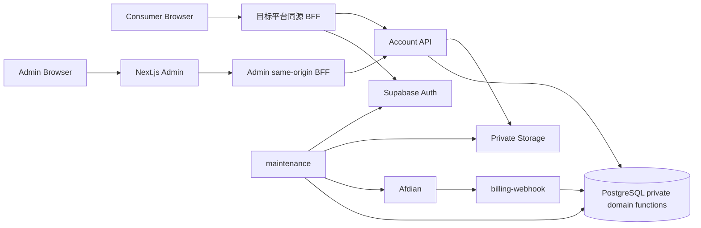

# Aisenhubplatform 架构文档

本文档集是 Aisenhubplatform 的长期架构事实库。它用于开发、审查、故障排查和后续优化，不记录一次性实施步骤，也不以 Proposal、Review 或某次 Agent 会话作为最终事实源。

项目需求由 [`docs/spec`](../spec/README.md) 管理。Architecture 不是 Requirement 的替代品：spec 说明系统必须满足什么，architecture 说明当前系统如何满足它。两者不一致时应记录需求缺口或实现漂移，而不是用当前代码静默改写需求。

## 1. 文档目标

架构文档必须回答四类问题：

1. **系统当前由哪些模块组成，模块边界在哪里。**
2. **每个模块的权威数据、状态机、API、运行时和安全边界是什么。**
3. **模块之间如何依赖，哪些规则只能由某个模块决定。**
4. **开发或审查时应到哪里核对精确实现。**

每个模块文档还必须声明其负责的 `REQ-*`，使需求可以追踪到架构、计划和验证。

本轮整理遵循“先吸收、后清理”原则：现有 `docs/reference`、`docs/guides`、历史 Proposal、Review、源码注释和测试中的有效细节，在确认已经进入对应架构文档之前不得仅为了目录整洁而删除。Git 历史可以保存实施过程，但不能替代当前架构事实。

## 2. Requirement 与实现事实

Requirement 的权威入口是 [`docs/spec`](../spec/README.md)。需求与实现事实使用不同判断规则：

- 判断“系统应该满足什么”时，以 Active Requirement、用户明确要求和已接受决策为准；
- 判断“系统现在实际上怎么工作”时，以下面的实现事实优先级为准；
- Active Requirement 与实现不一致时，标记 `Planned/Partial` 或建立整改计划，不把缺陷改写成需求。

## 3. 实现事实源优先级

当文档与实现发生冲突时，按以下顺序核对：

1. 当前 canonical PostgreSQL migration 与约束；
2. `contracts/account/v1/openapi.json`、`contracts/admin/v1/openapi.json`；
3. 当前运行源码：`supabase/functions`、`apps/admin`、`packages/domain`、`platform-integration`；
4. 当前自动化测试和验证脚本；
5. 本目录架构文档；
6. `reference` / `guides`；
7. Review、Proposal、Archive 等历史或过程资料。

架构文档应主动吸收 1–4 的事实，并在发现旧文档漂移时以当前实现修正文档，而不是把旧兼容模型重新带回系统。

## 4. 系统模块地图

### 4.1 业务与控制面模块

| 模块 | 核心职责 | 主要代码/数据 | 主要外部面 |
| --- | --- | --- | --- |
| [平台与租户](modules/platform-tenancy.md) | Platform、Origin、Platform Key、平台作用域与接入 readiness | `platforms`、`platform_auth_origins`、`private.platform_api_keys` | Admin platform API、Platform Key |
| [身份与安全](modules/identity-security.md) | Supabase Auth、Session、Principal、System Admin、MFA、recent proof | Auth schema、`identity_lifecycle`、`system_admin`、`admin_step_up` | Account/Admin Auth 边界 |
| [账户与资料](modules/accounts-profile.md) | Platform Account、Profile、Preferences、Account 360、账户治理 | `platform_accounts`、profiles/preferences、tags/notes/governance | Account/Profile/Preferences、Admin Account API |
| [商业目录](modules/commerce-catalog.md) | Plan、Offer、Price、Provider Mapping、购买策略 | `plans`、offers/prices、`billing_provider_products`、commerce policy | `/v1/plans`、`/v1/commerce/offers`、Admin Commerce |
| [支付与结算](modules/billing-settlement.md) | Checkout、Webhook、Provider、Order、Settlement、Reconciliation、Billing jobs | billing_* 表、billing-webhook、maintenance billing | Checkout、Admin Billing、Afdian |
| [权益与兑换](modules/entitlements-redemption.md) | Grant/Event ledger、Subscription projection、兑换码、Admin correction | subscriptions/grants/events、redemption_* | subscription/redeem、Admin entitlements/campaigns |
| [Config 与 Storage](modules/config-storage.md) | Config、immutable Version、Gallery、私有 Storage ledger、容量与清理 | platform_config_*、file policy、file write attempts | Config/Gallery API、Storage |
| [Feedback 与支持](modules/feedback-support.md) | 用户反馈、图片附件、状态/标签/备注、导出与删除 | platform_feedback*、attachment write attempts | Account Feedback、Admin Feedback |
| [审计、删除与维护任务](modules/audit-lifecycle-operations.md) | Audit、Global Delete、Retention、Job lease/fence、备份删除屏障 | audit_logs、deletion_*、job_leases、backup/tombstone | Admin Audit、Maintenance |
| [Admin 控制台](modules/admin-console.md) | Admin Web、Shell、BFF、UI/UX、Session Manager、Global/Platform workspace | `apps/admin`、`@kit/ui` | 浏览器 Admin |
| [Consumer 接入与 API 合同](modules/consumer-api-integration.md) | canonical OpenAPI、platform-integration、Conformance Harness、Registry | `contracts`、`platform-integration`、`tests/consumer-harness` | 外部/自营 Consumer HTTP |

### 4.2 跨模块基础设施

| 基础设施 | 职责 |
| --- | --- |
| [数据库与权限模型](foundations/database-security.md) | PostgreSQL schema、RLS、executor/domain-owner、context、security-definer、事务与租户完整性 |
| [运行时与部署](foundations/runtime-deployment.md) | Supabase Edge Functions、Vercel Admin、Storage、Provider、Maintenance 调度、环境配置 |
| [工程技术栈](foundations/engineering-stack.md) | Monorepo、Node/pnpm/Deno/TS、共享 package、UI 技术、测试、CI 与质量门槛 |

## 5. 总体调用关系

核心规则是：**Browser 不直接持有 Platform Key、数据库特权凭据或 Storage 写权限；HTTP adapter 负责认证与协议，数据库 private domain function 负责最终业务不变量。**

## 6. 数据库规模与当前基线

当前 prelaunch canonical baseline 定义 42 个 `public` 业务表和 19 个 `private` 控制/恢复表；随后 `system_admin_resilience` forward migration 新增 `private.system_admin_operations`，因此当前 schema 总体为 **42 个 public 业务表 + 20 个 private 控制/恢复表**。精确字段、索引、FK、CHECK 和函数授权以 `supabase/migrations` 为最终依据。

当前 canonical HTTP 合同经 `pnpm contracts:check` 验证为：

- Account v1：40 operations；
- Admin v1：78 operations；
- Platform Integration capability index：11 capabilities。

文档中若出现旧的 46/63 等 operation 数量，只代表历史版本，不得作为当前架构事实。

## 7. 模块依赖原则

- Platform 是所有平台业务数据的第一租户边界；`platform_id` 不能由浏览器覆盖服务端凭据映射出的作用域。
- Global Identity 与 Platform Account 分层：Auth 用户是全局身份，账户、Profile、Preferences、权益、Config、Feedback 是平台范围事实。
- Commerce 只定义“卖什么、多少钱、如何映射 Provider”，不能直接制造权益。
- Billing 只在支付事实完成验证后通过受控 settlement 进入 Entitlement ledger。
- Entitlement ledger 是访问权益的权威历史；`subscriptions` 只是当前投影。
- Config/Feedback 的对象字节始终由私有 Storage ledger 和受控服务端 adapter 管理，数据库 metadata 不等于对象已写入或已删除。
- Admin UI 不构成授权边界；高风险动作必须由 Account API + private SQL 再检查。
- Maintenance 网络调用不能持有数据库事务；所有长期任务使用可恢复状态、lease/fencing 或明确幂等语义。

## 8. 架构资料吸收矩阵

下表用于防止整理过程中丢失细节。状态“已吸收（第一轮）”表示核心事实已进入新模块文档，但原来源仍保留，后续还需做逐节 parity review；“待二次核对”表示不能删除来源。

| 来源 | 主要目标文档 | 当前状态 |
| --- | --- | --- |
| [architecture/overview.md](overview.md) | 本索引、runtime、database | 已吸收（第一轮） |
| [architecture/deployment.md](deployment.md) | runtime-deployment | 已吸收（第一轮） |
| [architecture/modules/identity-security.md](modules/identity-security.md) | identity-security、accounts、operations、database | 保留为当前详细来源 |
| [architecture/modules/entitlements.md](modules/entitlements.md) | commerce、billing、entitlements | 已吸收（第一轮），原文保留供细节追溯 |
| [architecture/modules/files-jobs.md](modules/files-jobs.md) | config-storage、feedback、operations | 已吸收（第一轮），原文保留供细节追溯 |
| [architecture/modules/frontends.md](modules/frontends.md) | admin-console、consumer-api | 已吸收（第一轮），原文保留供细节追溯 |
| [architecture/reference/data-model.md](reference/data-model.md) | 全部领域模块、database | 已迁入 Architecture Reference，继续作为精确查询层 |
| [architecture/reference/api.md](reference/api.md) | consumer-api、各业务模块 | 已迁入 Architecture Reference；2026-10-15 修正已知 Feedback/Admin 安全语义漂移 |
| [architecture/reference/contracts.md](reference/contracts.md) / [consumer matrix](reference/contract-consumer-matrix.md) | consumer-api、database | 已迁入 Architecture Reference；当前 Account 40 / Admin 78 contract 事实已核对 |
| [architecture/reference/configuration.md](reference/configuration.md) | runtime-deployment、billing、security | 已迁入 Architecture Reference；Billing Cron 与其他 schedule metadata 证据边界已核对 |
| [architecture/reference/maintenance-callers.md](reference/maintenance-callers.md) | runtime-deployment、operations | 已迁入 Architecture Reference，继续保存精确 Local/Hosted 调用证据 |
| [architecture/reference/toolchain.md](reference/toolchain.md) | engineering-stack | 已迁入 Architecture Reference；System Admin terminology 已修正 |
| `apps/admin/DESIGN.md` / `PRODUCT.md` | admin-console | 已吸收（第一轮），原文继续作为设计系统源 |
| Admin 前端架构审查 + 历史 UI/UX Review | admin-console、engineering-stack；建议项留在 review | 第二轮 parity 已完成；当前 UI/BFF/Auth/Design System 事实已收敛，ADM-008/009 保持 Partial、ADM-010 保持 Planned，历史静态缺陷不回灌为当前事实 |
| 已完成/被后续主干吸收的 Billing / MFA 实施计划 | commerce、billing、entitlements、identity、admin、operations | 稳定事实已进入 Architecture/Spec；过程资料按 Git 历史追溯，真实剩余 Requirement 与环境验收统一进入 `docs/plans/TODO.md` |
| 已完成历史 Plan/Proposal / Review | 对应模块 | P1–P6 parity 后当前事实已进入长期层；原过程资料按 Git 历史追溯 |
| `optimization-intake/platform-account-workbench-architecture.md` | accounts-profile + `spec/accounts-profile.md` | 第二轮 parity 已核对；发现 Auth Identity 局部降级尚未实现，`REQ-ACC-004` 标记 Partial |
| `optimization-intake/config-resource-system-architecture.md` | config-storage + `spec/config-storage.md` | 第二轮 parity 已核对；slot 降级、live author、schema compatibility 等已按当前 SQL/Test 吸收 |
| `optimization-intake/commercial-subscription-operations-architecture.md` | commerce-catalog、billing-settlement、entitlements-redemption + 对应 spec | 第二轮 parity 已核对核心运营读模型、Cancel/Refund/Revoke 和指标口径；只写入当前已落地事实 |
| 历史 `platform-feedback-system` Proposal | feedback-support + `spec/feedback-support.md` | 第二轮 parity 已完成；Submit 终态附件语义、标签上限、Client Context、CSV/batch delete、Overview 聚合等已按当前 SQL/runtime/test 修正 |
| 历史 `admin-global-audit-center` / lifecycle / prelaunch 运维资料 | audit-lifecycle-operations + `spec/audit-lifecycle-operations.md` | 第二轮 parity 已完成；Audit v2、Retention、Global Delete、Maintenance capability、Billing Cron 与 Hosted 证据边界已按当前 SQL/runtime/test 收敛 |
| 历史 onboarding / remove-sdk / integration-surface / consumer-harness Proposal | platform-tenancy、consumer-api-integration + 对应 spec | 第二轮 parity 已完成；11 capabilities、无 runtime SDK、Harness/compatibility 边界已核对；历史 Admin Consumer Lab 已确认不属于当前实现 |
| 历史 system-admin resilience / security review / MFA hardening 计划 | identity-security、`spec/identity-security.md`、Admin spec | 第二轮 parity 与计划清理已完成；多管理员/readiness/recent-proof 当前事实已核对；`REQ-IAM-011` 保持 Partial，verified factor 删除与最后因子保护未落地；全局 Admin CSP 仍未实现，剩余项见 `docs/plans/TODO.md` |

## 9. 删除前的强制检查

任何来源文档未来要删除，至少同时满足：

1. 文档中的稳定事实已经有明确目标模块；
2. 表/字段/状态机/API/配置/安全规则/恢复语义均已逐项核对；
3. 目标架构文档与当前 migration/OpenAPI/source 一致；
4. 过程性验证结果若仍有长期价值，已转入 review 或架构中的“已验证边界”；
5. `pnpm docs:check`、`pnpm contracts:check`、`git diff --check` 通过；
6. 删除不破坏仍在执行的计划或外部链接。

满足上述检查后，已完成或已被当前 Requirement/Architecture 完整吸收的过程计划默认删除；其历史由 Git 保留，未完成工作统一回到 `docs/plans/TODO.md` 或新的独立 Plan，避免旧计划继续成为第二事实源。
