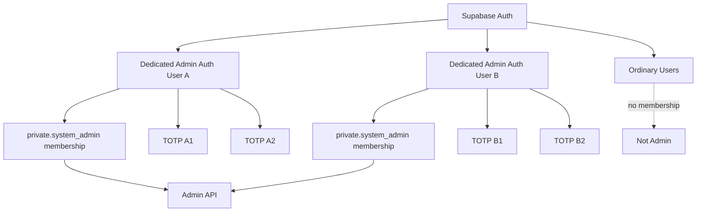

# System Admin 多管理员与灾备韧性设计

状态：In Progress（实现完成，最终 Local R3 验证 BLOCKED）  
制定日期：2026-10-14  
关联：[总计划](plan.md) · [Admin 安全管理与 MFA 整改](../admin-security-mfa-hardening/design.md) · [身份与安全当前架构](../../architecture/modules/identity-security.md) · [运维当前规则](../../guides/operations.md)

## 1. 背景与问题

当前 `private.system_admin` 使用 `singleton_id = 1`，最多只有一个 System Admin。现有 Admin 安全方案已经支持同一管理员绑定多个 verified TOTP factor，因此“单个 MFA 设备损坏”可以通过备用 factor 缓解；但管理员 Auth 身份本身仍是单点：若唯一管理员同时遭遇邮箱/密码恢复失败、Auth 用户被封禁或损坏、全部 factor 丢失，应用内没有第二个独立管理员可接管，只能依赖离线数据库/Auth 运维恢复。

本方案把问题从“单个管理员的 MFA 恢复”提升为“管理员控制面的身份高可用”。目标不是建立 RBAC，而是在继续保持单一 System Admin 权限级别的前提下消除管理员身份 SPOF。

## 2. 已确定的架构决定

1. 取消 `system_admin` 的单例约束，System Admin 改为服务端数据库维护的 membership 集合。
2. 正常运行至少保持 **2 个 active System Admin**；`pending` 管理员不计入可用管理员数量。
3. 所有 System Admin 权限完全相同。本方案不增加 RBAC、平台管理员、只读管理员、菜单权限或权限组。
4. 每个 active System Admin 的生产就绪目标为至少 **2 个 verified TOTP factor**，且不同管理员应使用独立的邮箱/恢复链和认证设备。
5. Admin 权限仍只由数据库 membership 决定，不写入 JWT `user_metadata` / `app_metadata`，不依赖客户端声明。
6. 新增、移除、激活管理员属于高风险身份变更，必须要求当前 active 管理员的 AAL2 + recent MFA，并进入安全审计。
7. 普通在线路径不得把 active 管理员数量降到 2 以下。若当前只有两名 active 管理员，需要先新增并激活第三名，再移除旧管理员。
8. 首次环境 bootstrap 和“全部管理员均不可用”的灾难恢复继续使用离线受控运维入口；不存在匿名网页 bootstrap、MFA 绕过页或长期隐藏后门账号。
9. 开发/测试环境可以在明确隔离的 fixture/reset 中直接创建合成 Auth 用户和 membership；Production 的日常管理员变更不得依赖手工 SQL。

## 3. 目标身份模型



Supabase Auth 继续负责“用户是谁、session 是否有效、AAL/factor 状态”；`private.system_admin` 负责“该 Auth 用户是否拥有 System Admin membership”。这两个事实不得合并到 JWT metadata。

### 3.1 专用管理员身份

System Admin 必须使用专用 Auth identity，不应把已有普通 Consumer 用户直接提升为管理员。服务端在添加 membership 前至少确认：

- Auth 用户存在且未被删除/封禁；
- 目标用户不是当前平台业务身份的普通使用账号，避免管理员专用身份与 Consumer 生命周期混用；
- 目标用户尚无 active/pending System Admin membership。

管理员 Auth 用户如何创建与管理员 membership 如何授予是两个动作。首版可以复用受控 Supabase Auth Admin/运维入口创建专用 Auth 用户，再由 Admin 安全页面授予 membership；不要求本方案同时建设邮件邀请系统。

## 4. 数据模型

目标上移除 `singleton_id`，把 `private.system_admin` 收敛为 membership 表。建议最小字段：

```sql
private.system_admin (
  user_id uuid primary key references auth.users(id) on delete restrict,
  state text not null check (state in ('pending', 'active')),
  created_at timestamptz not null default now(),
  activated_at timestamptz null,
  created_by_user_id uuid null references auth.users(id) on delete restrict
)
```

字段名以实施时最终 migration/reference 为准；本设计冻结的是语义：

- `pending`：已授予管理员 onboarding 资格，但不计入“至少 2 个可用管理员”；只能进入必要的 Admin security/MFA onboarding 面。
- `active`：完成目标 MFA onboarding 后进入正常 System Admin 授权集合。
- 删除 membership 代表撤销管理员资格；历史通过安全审计保留，不用软删除行冒充 active membership。

### 4.1 为什么需要 pending

新管理员需要先成为受认可的 Admin identity，才能进入受限 MFA onboarding；但不能因为刚写入 membership 就立刻被视为灾备冗余。`pending` 把“可以完成管理员注册”与“已经是可接管的 active 管理员”分开。

### 4.2 最小 active 数量与并发

“至少 2 个 active 管理员”不能只靠页面检查。所有正常 membership mutation 必须进入 PostgreSQL private domain function，并串行化管理员集合修改；实施可使用受控表锁或等价的事务级协调，确保两个并发删除请求不能都基于旧计数通过。

删除 active membership 时，在同一事务内锁定管理员集合、重新计数，并拒绝任何会让 active 数量 `< 2` 的操作。`admin_executor` 不获得基础表直接 DML 权限。

离线 `recovery_executor` 属于显式 break-glass 边界，用于在正常 Admin 路径不可用时恢复 membership 能力，但仍不允许把 active 数量降到 2 以下；恢复流程必须先补足可用管理员容量，再移除失效 membership，并由 runbook、限时凭据和恢复审计约束。

## 5. 授权与 MFA 不变量

普通 Admin 请求继续满足：

1. 有效 Supabase Auth user/session；
2. `private.system_admin.state = 'active'`；
3. 当前请求达到 AAL2；
4. 高风险操作再检查现有 recent MFA proof。

`pending` member 仅允许访问完成 onboarding 所需的最小 security status、factor list/enroll/verify、退出等路径，不允许读取或修改普通业务管理数据。

管理员 membership 的 `add / activate / remove` 全部要求 active actor + recent MFA。添加目标管理员后不会自动执行其 MFA enrollment；目标用户必须独立登录、绑定自己的 TOTP factor 并完成验证。

### 5.1 双 TOTP 目标

每个 active System Admin 的生产就绪目标是至少 2 个 verified TOTP factor。新增管理员只有满足该目标后才允许从 `pending` 激活为 `active`。实现时由服务端通过 Supabase Auth 的可信 factor 查询验证数量与状态，浏览器提交的 factor 数量或 factor id 不作为权威依据。

当前 Admin 产品只提供 verified TOTP 的查询、验证与新增备用因子，不提供 verified factor 删除入口；因此不会从应用路径把 active 管理员降到 2 个 verified factor 以下。若未来增加 verified factor 删除，必须在服务端维护该下限。Supabase 底层 Auth 管理能力仍可绕过应用 UI，因此还需要 Admin readiness 检测和运维告警，本方案不声称仅靠应用 UI 可以全局阻止底层管理员修改 factor。

## 6. 管理员生命周期

### 6.1 首次 bootstrap

全新环境没有 active System Admin 时，不开放匿名网页注册管理员。受控 operator 使用基础设施权限：

1. 创建两个独立的专用 Supabase Auth 用户；
2. 建立两条 `pending` membership；
3. 两个用户分别登录 Admin，只能进入 MFA onboarding；
4. 每个用户配置并验证至少两个独立 TOTP factor；
5. 通过受控激活流程分别转为 `active`；
6. 验证 active admin 数量 `>= 2`、两个账号均可独立登录/AAL2；
7. 关闭 bootstrap/recovery 临时权限并记录审计。

开发和自动化测试可由 reset/fixture 直接准备合成 Auth 用户与 membership，但必须保证只指向 Local/Test，且测试结束恢复隔离状态。

### 6.2 正常新增管理员

```text
Active Admin A
  -> recent MFA
  -> 选择/指定一个已存在的专用 Auth user
  -> 服务端验证目标身份符合管理员专用约束
  -> 创建 pending membership + audit
  -> Admin B 独立登录
  -> B 完成 2 个 verified TOTP
  -> 服务端可信检查 factor 状态
  -> membership 激活
  -> readiness = healthy
```

首版不要求 Admin UI 直接创建 Supabase Auth 用户。若未来增加“邀请管理员”能力，应作为独立扩展，通过服务端 Auth Admin API 创建/邀请专用身份，不能把 service-role secret 暴露给浏览器。

### 6.3 正常移除管理员

移除要求 actor recent MFA、明确目标、reason code 和 operation id。数据库在事务内重新检查：

- actor 仍是 active System Admin；
- target 仍是 active/pending member；
- 移除 active target 后仍有至少 2 个 active member；
- 幂等/并发结果一致。

移除成功后撤销目标管理员所有可撤销 Admin session/recent-proof，并记录 security event。若仅剩两名 active 管理员，必须先添加并激活替代者。

### 6.4 灾难恢复

只有以下情况进入 break-glass：

- 所有 active System Admin 均无法完成 Auth 登录/MFA；
- Auth/Admin 部署故障导致正常管理员变更路径不可用；
- membership 数据损坏导致无可用 active 管理员。

恢复不开放网页绕过。由基础设施所有者使用限时 `recovery_executor` / Auth 管理能力，在工单/恢复 ID 下创建或恢复专用 Auth 用户、重建 pending membership、完成双 TOTP 后激活，并先把 active 容量恢复到至少 2；之后才允许清理失效 membership。恢复 add/activate/remove 使用与正常路径相同的双 TOTP 与 2-active 安全下限，随后撤销旧 session/recent-proof、轮换恢复中接触的 secret、关闭恢复权限，并保留可调查审计。

## 7. Admin API 与 UI 目标

目标最小能力：

- Security 页面显示管理员成员列表与 `pending/active` 状态；
- 显示平台可确认的 MFA readiness（不显示 secret）；
- 显示当前 active admin 数量与健康状态；
- recent MFA 后添加 pending member；
- pending 用户独立完成 MFA onboarding；
- recent MFA 后移除 member；
- 当操作会导致 active admin `< 2` 时明确拒绝并提示先添加替代管理员。

具体 OpenAPI 路径在实施阶段冻结，但必须保持服务器权威、operation/idempotency 与审计边界，不允许浏览器直连数据库或携带高权限 Supabase secret。

## 8. 安全审计

至少记录：

- `system_admin.membership_added`；
- `system_admin.activated`；
- `system_admin.membership_removed`；
- `system_admin.recovery_started/completed/failed`；
- 与管理员激活相关的 MFA 安全事件。

审计包含 actor user id、target user id、request id、operation id、reason code、结果和时间；不得记录密码、TOTP secret、QR 内容、Cookie、access/refresh token 或 recovery credential。

## 9. Readiness 与运维规则

Admin 安全页和发布门槛应把以下状态视为不健康：

- active System Admin `< 2`；
- 任一 active System Admin 的 verified TOTP `< 2`；
- active membership 指向已删除/封禁的 Auth 用户；
- 管理员 membership 与 Auth 状态无法读取或不一致。

两个管理员必须尽量使用独立恢复链。若 Admin A/B 共用同一邮箱控制权、同一唯一手机或同一不可恢复密码库，数据库层虽然有两条 membership，仍不能视为真正消除了身份 SPOF。

## 10. 非目标

- RBAC、角色组、细粒度权限、平台管理员、客服/财务管理员；
- Passkey/WebAuthn、短信/邮件 OTP、Recovery Code 产品化；
- 普通 Consumer 用户一键晋升管理员；
- 浏览器直接管理 Supabase service-role 或数据库；
- 自动化 Production break-glass；
- 以第二管理员替代 backup/recovery runbook。

## 11. 迁移与兼容原则

实施属于 R3 身份/数据库变更。不得修改已经应用的 migration 来伪装升级；按实施时真实基线使用固定 Supabase CLI 生成 forward migration，并同时验证 fresh database 与从当前已发布 schema 的升级路径。

所有 `system_admin` singleton 假设都必须被显式清点：SQL helper、Account/Admin API、Admin Shell/security status、普通 Consumer 拒绝管理员身份的检查、测试 fixture、恢复脚本、reference/architecture/guides。不能只改表结构后依赖旧查询“碰巧仍工作”。

## 12. 完成标准

- 两个独立 active System Admin 可以分别登录、达到 AAL2 并执行同一套管理权限；
- 新管理员从 pending 完成双 TOTP onboarding 后才计入 active readiness；
- 所有正常路径都不能把 active admin 数量降到 2 以下，并发删除也不能绕过；
- 移除管理员后旧 session/recent-proof 不再可用于 Admin；
- Consumer/普通账户入口继续拒绝所有 System Admin identity；
- Admin membership 不依赖 JWT metadata；
- Local 完成“一个管理员完全失联，另一个在线接管并替换”的恢复演练；
- Local 完成“全部管理员失联”的 break-glass 演练并留下审计证据；
- 当前架构、reference 和运维文档在实际实施完成后同步，不提前把目标架构写成已实现。

