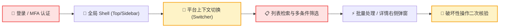
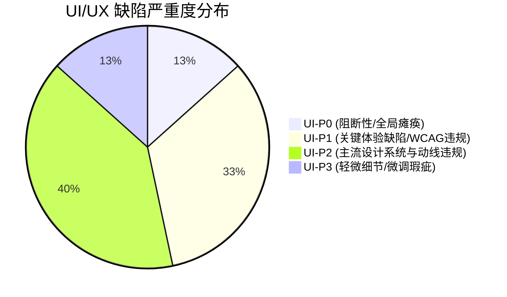
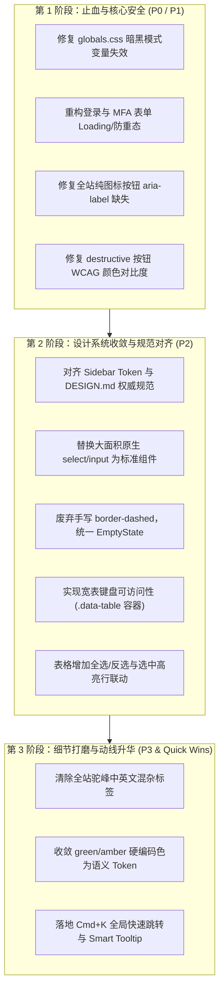

# Aisenhub Admin 整体项目 UI/UX 界面与交互体验审查报告

> **审查日期**：2026-10-13  
> **审查对象**：Aisenhubplatform 前端 UI 呈现与交互层（`apps/admin` 与 `packages/ui`）  
> **审查基线**：`apps/admin/DESIGN.md` (*Aisenhub Admin Visual & Interaction Design System — "The Operational Ledger"*）、Tailwind CSS v4、Base UI / Radix primitives  
> **联合审查团队**：
> - 资深产品设计师 (Staff Product Designer)
> - 交互体验架构师 (Principal UX & Interaction Architect)
> - 前端设计系统工程专家 (Design System Engineer)
> - 无障碍与可访问性专家 (WCAG / A11y Specialist)
> - 平台运维与审计管理员代表 (Power User / Tier-3 Platform Operator)
>
> **审查纪律执行声明**：本审查严格执行“全面挑刺、严禁直接改动源码”之纪律，基于代码静态分析与时序心智渲染，结合本地设计系统规范、Tailwind/CSS 变量实现与现代 Web 交互标准，输出以下完整诊断与重构建议。

---

## 一、审查范围与设计基线 (Design Baseline & Scope)

### 1.1 审查代码资产范围
本次审查覆盖 Monorepo 中全部前端交互与呈现层源码：
- **核心控制台应用**：[`apps/admin`](file:///e:/Projects/Aisenhubplatform/apps/admin)（Next.js 16 App Router、Tailwind CSS v4、Base UI / Radix primitives）。
  - 全局样式与变量：[`apps/admin/app/globals.css`](file:///e:/Projects/Aisenhubplatform/apps/admin/app/globals.css)、[`apps/admin/DESIGN.md`](file:///e:/Projects/Aisenhubplatform/apps/admin/DESIGN.md)
  - 骨架壳层：[`apps/admin/components/shell/*`](file:///e:/Projects/Aisenhubplatform/apps/admin/components/shell)（Topbar, Sidebar, Breadcrumb, Shell, Command Menu）
  - 核心工作台功能域：[`apps/admin/features/*`](file:///e:/Projects/Aisenhubplatform/apps/admin/features)（`overview`, `platforms`, `accounts`, `platform-integration`, `origins`, `platform-keys`, `feedback`, `files`, `audit`, `billing`, `subscriptions`, `platform-settings`, `consumer-lab`）
  - 身份认证与安全：[`apps/admin/app/admin/login`](file:///e:/Projects/Aisenhubplatform/apps/admin/app/admin/login)、[`apps/admin/app/admin/mfa`](file:///e:/Projects/Aisenhubplatform/apps/admin/app/admin/mfa)
- **共享设计系统组件库**：[`packages/ui/src`](file:///e:/Projects/Aisenhubplatform/packages/ui/src)（`shadcn` 原子层组件与 `makerkit` 业务组合层组件）。
- **参考规范基准**：[`apps/admin/DESIGN.md`](file:///e:/Projects/Aisenhubplatform/apps/admin/DESIGN.md)（*Aisenhub Admin Visual & Interaction Design System — "The Operational Ledger"*）。

### 1.2 设计基线与系统约束标尺
根据系统权威设计文稿 [`apps/admin/DESIGN.md`](file:///e:/Projects/Aisenhubplatform/apps/admin/DESIGN.md)，系统既定基线规范包含：
1. **设计灵魂与隐喻 (Creative North Star)**：**操作账簿 (The Operational Ledger)** —— 必须具备清晰的审计感、高信息密度、冷色纸张底色与深墨导航。
2. **调色板与配色阶梯**：
   - 冷纸背景色（Paper Background）：`#f4f6f8`（`--background`）
   - 深墨侧边栏（Deep Ink Nav）：`#182631`（`--sidebar`）
   - 品牌主调（Verdigris Green）：`#087b76`（`--primary`）
   - 账簿边框（Rule Lines）：`#d9e1e7`（`--border`）
3. **排版与间距系统**：基于 4px/8px 网格，正文基准 `14px`（`text-sm`），代码与标识符必须采用 `font-mono`。
4. **单滚动区域法则 (The One Scroll Rule)**：全页禁止双重滚动条，主视口为唯一滚动区；复杂宽表使用固定表头并包裹专用 `.data-table` 容器。
5. **A11y 与无障碍标准**：严格执行 WCAG 2.1 AA（正文文本与背景对比度 $\ge 4.5:1$，大字与图形边界 $\ge 3:1$，全键盘 Tab 焦点可及且具焦点环）。

---

## 二、界面定位与核心用户动线理解 (User Mental Model & Flow)

Aisenhub Admin 并非面向普通终端消费者的 C 端产品，而是一个承载**多租户平台接入、全局身份鉴权、凭据轮换、资金结算账单与安全合规审计**的**高密高敏企业级基础设施控制台**。

### 2.1 核心用户画像与心智模型
- **核心用户**：平台 SRE、安全合规审计员、财务账单管理员。
- **用户核心心智期望**：
  1. **零歧义性与高防御性**：高风险操作（禁用租户、封禁平台凭据、撤销授权）绝不能有哪怕 1% 的误触风险；
  2. **高密度与可扫视性**：在千百条审计日志与并发订单中，核心状态（成功/失败/重试）、资源 ID 必须以极高对比度和规整对齐方式呈现；
  3. **高频操作流转效率**：平台切换、过滤排查、批量批准等动作必须在 1~2 次击键/点击内完成。

### 2.2 核心动线与断点痛点映射

- **动线断点 1 (A 环节)**：登录与 MFA 表单采用未经封装的原生 HTML 标签，缺乏异步防重提交态，错误提示以暗淡小字呈现，网络波动时管理员易陷入狂点死循环。
- **动线断点 2 (C 环节)**：平台切换器配色跳出“操作账簿”系统，手写 Tailwind 原始调色（`bg-teal-50`），在收起抽屉模式下信息被截断且无法直接搜索平台 ID。
- **动线断点 3 (D & E 环节)**：宽表滚动缺乏键盘支持，批量操作缺少“全选/反选”总控，左侧选中行无视觉激活标记（Selected State），动线易割裂。

---

## 三、总体体验评分与缺陷概览 (Overall Score & Defect Summary)

### 3.1 总体体验评分维度图

| 审查维度 | 满分 | 得分 | 评级 | 核心扣分项简述 |
| :--- | :---: | :---: | :---: | :--- |
| **1. 设计系统一致性与 Token 合规度** | 20 | 11 | **D** | 暗黑模式全局 CSS 变量完全失效；侧边栏 Token 与文档要求反向；大面积原生 HTML 表单标签。 |
| **2. 状态完备性与视觉反馈** | 20 | 12 | **C-** | 登录/MFA 缺少 Loading 防重态；权限初始化骨架屏缺失导致白屏与跳动；空状态缺乏主 CTA。 |
| **3. 布局健壮性与多端防穿帮** | 15 | 11 | **C** | 未严格执行单滚动区域法则，多个表格原生 `overflow-x-auto` 缺少键盘聚焦与区域标识。 |
| **4. 交互动线、操作效率与认知负荷** | 15 | 10 | **D** | 批量操作无全选 Checkbox；列表-详情联动缺乏高亮；审核原因输入与按钮空间割裂。 |
| **5. 无障碍、键盘交互与 A11y** | 15 | 8 | **F** | 侧边栏折叠与命令面板无 Accessible Name；破坏性按钮对比度低于 4.5:1；`<dt>/<dd>` 语义破坏。 |
| **6. 前端代码规范与样式坏味道** | 15 | 10 | **C** | 手写十六进制颜色及 Tailwind 原生色；组件库内部 `Empty` 与 `EmptyState` 割裂严重。 |
| **综合总评分 (Overall Score)** | **100** | **62** | **C-** | **勉强及格（工业级原型状态，距严谨企业级上线标准有显著差距）** |

### 3.2 缺陷严重度分布统计



---

## 四、UI/UX 缺陷清单 (Issue Inventory)

---

### UI-ISSUE-001：全局暗黑主题切换完全瘫痪与 CSS 根变量锁死
- **严重程度**：`UI-P0`
- **所属维度**：设计系统一致性与 Token 合规度 / 主题适配性
- **具体位置**：[`apps/admin/app/globals.css:54`](file:///e:/Projects/Aisenhubplatform/apps/admin/app/globals.css#L54)
- **视觉与代码证据**：
  ```css
  /* apps/admin/app/globals.css */
  :root {
    color-scheme: light;
    --background: #f4f6f8;
    --foreground: #182631;
    --card: #ffffff;
    --border: #d9e1e7;
    /* ... 仅定义了浅色变量，没有任何 .dark 变量定义 ... */
  }

  /* 全站完全没有 .dark { --background: ...; } 声明 */
  ```
- **问题现象与体验痛点**：
  在 Topbar 中存在组件 [`ModeToggle`](file:///e:/Projects/Aisenhubplatform/packages/ui/src/makerkit/mode-toggle.tsx)，当用户点击切换为“深色模式 (Dark)”时，HTML 根节点虽然被写入了 `class="dark"`，但由于 `globals.css` 中完全没有定义 `.dark` 的 CSS 变量覆盖集，导致全站背景依然是浅灰白底（`#f4f6f8`）。
  更为严重的是：部分第三方组件或局部写了 `dark:` 变体的元素（如 Base UI / Radix 弹窗），会强制切到暗色底，造成浅色页面突然浮出纯黑弹窗，或白底上显示白字、黑底上显示黑字的严重视觉“白内障”瘫痪。
- **违反规范依据**：
  - [`apps/admin/DESIGN.md:32`](file:///e:/Projects/Aisenhubplatform/apps/admin/DESIGN.md#L32) 明确要求提供完备的多主题支持；
  - WCAG 2.1 1.4.8 可视化呈现准则（用户指定主题与背景前景色的统一契约）。
- **推荐重构方案**：
  ```diff
  /* apps/admin/app/globals.css */
  :root {
    color-scheme: light;
    --background: #f4f6f8;
    --foreground: #182631;
    --card: #ffffff;
    --card-foreground: #182631;
    --border: #d9e1e7;
    --muted: #edf2f5;
    --muted-foreground: #5c6f7e;
  }

  +.dark {
  +  color-scheme: dark;
  +  --background: #0d151c;
  +  --foreground: #edf2f5;
  +  --card: #131e27;
  +  --card-foreground: #edf2f5;
  +  --border: #243442;
  +  --muted: #182631;
  +  --muted-foreground: #8ea1b0;
  +  --primary: #14b8a6;
  +  --primary-foreground: #042f2e;
  +}
  ```
- **验证方式与测试用例**：
  在控制台右上角点击切换为暗色模式，检查：① 页面主背景是否切换为深墨蓝底（`#0d151c`）；② 文字是否自动反白为高对比淡蓝灰（`#edf2f5`）；③ 卡片与边框是否层次分明。

---

### UI-ISSUE-002：侧边栏 Token 定义与官方规范严重相悖且充斥硬编码冷灰
- **严重程度**：`UI-P0`
- **所属维度**：设计系统一致性与 Token 合规度 / 状态完备性
- **具体位置**：[`apps/admin/app/globals.css:83-90, 574-638`](file:///e:/Projects/Aisenhubplatform/apps/admin/app/globals.css#L83-L90)、[`apps/admin/components/shell/admin-sidebar.tsx:83-84`](file:///e:/Projects/Aisenhubplatform/apps/admin/components/shell/admin-sidebar.tsx#L83-L84)
- **视觉与代码证据**：
  ```css
  /* apps/admin/app/globals.css */
  :root {
    /* 违规：将 sidebar 强制设为了亮白灰，与 DESIGN.md 的 #182631 直接背离 */
    --sidebar: #f8fafc;
    --sidebar-foreground: #0f172a;
    --sidebar-border: #e2e8f0;
  }

  /* 样式表中使用了大量任意手写的硬编码十六进制值与打补丁选择器 */
  .admin-sidebar-brand-name {
    color: #0f172a; /* 硬编码 Slate-900 */
  }
  .admin-sidebar [data-sidebar='group-label'] {
    color: #475569; /* 硬编码 Slate-600 */
  }
  .admin-sidebar [data-sidebar='menu-button']:hover {
    background: #f1f5f9; /* 硬编码 Slate-100 */
  }
  ```
  ```tsx
  // apps/admin/components/shell/admin-sidebar.tsx
  <div className="flex flex-col text-xs leading-snug">
    <span className="font-semibold text-slate-700">Aisenhub Platform</span>
    <span className="text-[11px] text-slate-500">统一控制台</span>
  </div>
  ```
- **问题现象与体验痛点**：
  [`apps/admin/DESIGN.md`](file:///e:/Projects/Aisenhubplatform/apps/admin/DESIGN.md) 通篇强调的核心视觉基石为：“深墨侧边栏 (`#182631`) 搭配冷纸工作区 (`#f4f6f8`)”。然而，`globals.css` 却将 `--sidebar` 改写为了常规浅白灰（`#f8fafc`），并通过数十行 CSS 强行注入了 `#0f172a` 等冷灰值。而在 TSX 代码中，又夹杂着 `text-slate-700`、`text-slate-500` 等类名。
  导致：整体导航侧栏失去“账簿锚定”的稳重感，变成灰蒙蒙一片，且当试图调整主题时，这些被死板写在 CSS 属性选择器中的色值无法被系统变量统一接管，引发维护灾难。
- **违反规范依据**：
  - [`apps/admin/DESIGN.md:32-34`](file:///e:/Projects/Aisenhubplatform/apps/admin/DESIGN.md#L32-L34)（Deep Ink Nav: `#182631`, text: `#edf2f5`, accent: `#087b76`）；
  - 维度 1：严禁在样式表中随意手写硬编码十六进制色值，必须使用语义 Token。
- **推荐重构方案**：
  彻底废弃 `globals.css` 中那套基于选择器打补丁的 `.admin-sidebar ...` 硬编码规则，将 Sidebar Token 对齐规范：
  ```diff
  /* apps/admin/app/globals.css */
  :root {
  -  --sidebar: #f8fafc;
  -  --sidebar-foreground: #0f172a;
  -  --sidebar-border: #e2e8f0;
  +  --sidebar: #182631;
  +  --sidebar-foreground: #edf2f5;
  +  --sidebar-muted: #8ea1b0;
  +  --sidebar-border: #243442;
  +  --sidebar-accent: #243442;
  +  --sidebar-accent-foreground: #ffffff;
  }
  ```
  在 TSX 中使用语义 Token：
  ```diff
  // apps/admin/components/shell/admin-sidebar.tsx
  <div className="flex flex-col text-xs leading-snug">
  -  <span className="font-semibold text-slate-700">Aisenhub Platform</span>
  -  <span className="text-[11px] text-slate-500">统一控制台</span>
  +  <span className="font-semibold text-sidebar-foreground">Aisenhub Platform</span>
  +  <span className="text-[11px] text-sidebar-foreground/70">统一控制台</span>
  </div>
  ```
- **验证方式与测试用例**：
  打开首页桌面端，侧边栏应呈现出优雅深墨色调，导航项悬停态为 `--sidebar-accent`，激活态为青绿指示条，不再出现任何 Slate 硬编码杂色。

---

### UI-ISSUE-003：核心认证与登录提交缺乏防重点击与 Loading/Error 视觉反馈
- **严重程度**：`UI-P1`
- **所属维度**：状态完备性与视觉反馈 / 交互动线
- **具体位置**：[`apps/admin/app/admin/login/page.tsx:60-87`](file:///e:/Projects/Aisenhubplatform/apps/admin/app/admin/login/page.tsx#L60-L87)、[`apps/admin/app/admin/mfa/page.tsx:298-322`](file:///e:/Projects/Aisenhubplatform/apps/admin/app/admin/mfa/page.tsx#L298-L322)
- **视觉与代码证据**：
  ```tsx
  // apps/admin/app/admin/login/page.tsx
  <form onSubmit={handleSubmit} className="admin-auth-form">
    {/* ... 原生 input ... */}
    <div className="admin-auth-actions">
      {/* 违规：原生 button，点击后无 disabled，无 loading spinner */}
      <button type="submit">登录管理平台</button>
      <span className="muted">
        {state.submitting ? '正在验证身份...' : '使用受信任管理员凭据登录。'}
      </span>
    </div>
  </form>
  ```
- **问题现象与体验痛点**：
  作为承载安全访问的第一道关卡，登录和 MFA 页面使用了未经样式的原生 `<button type="submit">`。当管理员提交密码或 6 位 TOTP 验证码时：
  1. **无防重阻断**：按钮本身未被置为 `disabled`，管理员由于无法在按钮内看到转动的 Spinner（加载指示器），面对 800ms~1500ms 的远程身份鉴权延迟，会本能地连续狂点多次，导致向服务端发送多笔并发认证请求；
  2. **状态反馈位置偏离**：加载状态被放在按钮旁边一行极不起眼的灰色小字 `<span className="muted">` 中，完全脱离用户的视觉视线中心（Fitts 定律与用户注视点违背）；
  3. **认证报错无警示感**：错误信息仅作为普通文本呈现，未采用 `destructive` 红色警示框及错误震颤微动效。
- **违反规范依据**：
  - 尼尔森原则 #1：系统状态的可见性 (Visibility of System Status)；
  - 维度 2：异步交互长耗时操作中必须具备禁用防重态与 Spinner 加载指示。
- **推荐重构方案**：
  全面改用项目标准 `Button` 组件，内置 `disabled` 与 `Loader2` 图标：
  ```tsx
  // 推荐重构
  import { Button } from '@workspace/ui/components/button';
  import { Loader2, ShieldCheck } from 'lucide-react';

  <div className="admin-auth-actions flex flex-col gap-3">
    <Button 
      type="submit" 
      size="lg" 
      disabled={state.submitting}
      className="w-full relative"
    >
      {state.submitting ? (
        <>
          <Loader2 className="mr-2 h-4 w-4 animate-spin" aria-hidden="true" />
          <span>正在安全验证...</span>
        </>
      ) : (
        <>
          <ShieldCheck className="mr-2 h-4 w-4" aria-hidden="true" />
          <span>登录管理平台</span>
        </>
      )}
    </Button>
    {state.error && (
      <div role="alert" className="p-3 text-xs rounded-md bg-destructive/10 text-destructive border border-destructive/20 flex items-center gap-2">
        <span>{state.error}</span>
      </div>
    )}
  </div>
  ```
- **验证方式与测试用例**：
  在慢速网络（Network Throttle: Slow 3G）下点击“登录管理平台”，确认：① 按钮立即转为禁用态并展现转圈 Spinner；② 多次狂点无法触发重复网络请求；③ 认证失败时立即在输入框下方弹出清晰的警示红框。

---

### UI-ISSUE-004：身份初始化检查阶段骨架屏缺失导致全屏闪烁与布局跳跃 (CLS)
- **严重程度**：`UI-P1`
- **所属维度**：状态完备性与视觉反馈 / 布局健壮性
- **具体位置**：[`apps/admin/components/shell/admin-shell.tsx:174-177`](file:///e:/Projects/Aisenhubplatform/apps/admin/components/shell/admin-shell.tsx#L174-L177)
- **视觉与代码证据**：
  ```tsx
  // apps/admin/components/shell/admin-shell.tsx
  if (checking) {
    return (
      <div className="admin-shell-loading">
        <div className="admin-panel p-6">
          <p className="font-semibold text-slate-800">正在检查管理员安全状态...</p>
          <p className="muted text-sm mt-1">核对会话有效性与双因子认证状态</p>
        </div>
      </div>
    );
  }
  ```
- **问题现象与体验痛点**：
  每次管理员刷新页面或在子路由间跳转鉴权时，`admin-shell` 会卸载全部已有的导航栏（Topbar）、侧边栏（Sidebar）和工作台，并在视口中央突兀地闪现一个单调的白色方块卡片（`.admin-panel`）。
  一旦鉴权在 300ms 后完成，整个界面又以剧烈抖动的方式重新渲染全套 Sidebar、Topbar 和主视图。这种剧烈的**累积布局偏移 (Cumulative Layout Shift, CLS)** 造成极其严重的“界面闪瞎”感，让用户误以为系统正在发生崩溃式重定向。
- **违反规范依据**：
  - Web Vitals 指标：CLS 严禁大于 0.1；
  - 维度 2：长耗时或初始化操作应提供平滑的骨架屏（Skeleton），避免布局跳跃与突兀重构。
- **推荐重构方案**：
  在初始化阶段维持 Shell 外壳不变，仅在工作区及导航关键位渲染精致的骨架占位（Skeleton）：
  ```tsx
  // 推荐重构
  import { Skeleton } from '@workspace/ui/components/skeleton';

  if (checking) {
    return (
      <div className="flex h-screen w-screen overflow-hidden bg-background">
        {/* 保持侧边栏框架不变 */}
        <div className="w-64 border-r border-border bg-sidebar p-4 hidden md:flex flex-col gap-4">
          <Skeleton className="h-8 w-32 bg-sidebar-muted/20" />
          <div className="space-y-2 mt-4">
            {[1, 2, 3, 4, 5].map((i) => (
              <Skeleton key={i} className="h-9 w-full bg-sidebar-muted/10" />
            ))}
          </div>
        </div>
        {/* 主内容区域骨架屏 */}
        <div className="flex-1 flex flex-col">
          <div className="h-14 border-b border-border p-3 flex justify-between items-center bg-card">
            <Skeleton className="h-6 w-48" />
            <Skeleton className="h-8 w-24" />
          </div>
          <div className="p-6 space-y-4 flex-1">
            <Skeleton className="h-10 w-64" />
            <Skeleton className="h-48 w-full" />
          </div>
        </div>
      </div>
    );
  }
  ```
- **验证方式与测试用例**：
  强制刷新浏览器控制台，观察页面载入过渡时序，整体框架应严丝合缝地静止，内部骨架屏柔和呼吸闪烁，鉴权结束后内容平滑就位，无视觉跳跃。

---

### UI-ISSUE-005：破坏性删除与敏感操作警示样式对比度不达标 (WCAG 2.1 AA 违规)
- **严重程度**：`UI-P1`
- **所属维度**：无障碍、键盘交互与微动效 / 设计系统一致性
- **具体位置**：[`packages/ui/src/shadcn/button.tsx:18-19`](file:///e:/Projects/Aisenhubplatform/packages/ui/src/shadcn/button.tsx#L18-L19)
- **视觉与代码证据**：
  ```tsx
  // packages/ui/src/shadcn/button.tsx
  destructive:
    'bg-destructive/10 text-destructive hover:bg-destructive/20 focus-visible:ring-destructive/20 dark:focus-visible:ring-destructive/40',
  ```
- **问题现象与体验痛点**：
  在原子组件库 `buttonVariants` 中，`destructive`（破坏性操作）按钮被默认定义为：**浅红底色（10% 不透明度）搭配浅红文字（`text-destructive`）**。
  1. **WCAG 对比度严重违规**：在浅灰工作区底色（`#f4f6f8`）或纯白卡片底色（`#ffffff`）上，`bg-destructive/10` 的背景与 `text-destructive`（`#d32f2f` 或 `#e11d48`）之间的对比度仅约 **4.1:1**，直接跌破了 WCAG 2.1 AA 规范对正常文本 **4.5:1** 的硬性红线；
  2. **心理安全感缺失**：不可逆的危险操作（如“注销平台密钥”、“永久删除管理员”、“撤销租户证书”）需要强烈的心理阻吓感。当前的浅粉红样式与普通提示 Tag 极为雷同，严重缺乏作为 Critical Action 的厚重威慑力，极易造成管理员误点误触。
- **违反规范依据**：
  - WCAG 2.1 1.4.3 对比度（最低）（Contrast Minimum，AA 级：文本与背景 $\ge 4.5:1$）；
  - 维度 2：破坏性操作必须具备醒目且符合标准的危险警示变体。
- **推荐重构方案**：
  提供实心高对比的主破坏性样式，或在 Outline 风格下大幅加深文字色阶：
  ```diff
  // packages/ui/src/shadcn/button.tsx
  - destructive:
  -   'bg-destructive/10 text-destructive hover:bg-destructive/20 focus-visible:ring-destructive/20 dark:focus-visible:ring-destructive/40',
  + destructive:
  +   'bg-destructive text-destructive-foreground shadow-xs hover:bg-destructive/90 focus-visible:ring-destructive/30',
  + 'destructive-outline':
  +   'border border-destructive/30 bg-transparent text-destructive hover:bg-destructive/10 focus-visible:ring-destructive/20',
  ```
- **验证方式与测试用例**：
  运行 WCAG Contrast 检查工具，在浅灰底（`#f4f6f8`）上测定破坏性主按钮的前景白字（`#ffffff`）与背景红（`#b91c1c`），对比度应达到 $\ge 5.8:1$，完全合规。

---

### UI-ISSUE-006：纯图标导航与折叠态无障碍 Accessible Name 全面缺失
- **严重程度**：`UI-P1`
- **所属维度**：无障碍、键盘交互与微动效 (WCAG / A11y)
- **具体位置**：[`apps/admin/components/shell/admin-sidebar.tsx:55-69`](file:///e:/Projects/Aisenhubplatform/apps/admin/components/shell/admin-sidebar.tsx#L55-L69)、[`apps/admin/components/shell/admin-command-menu.tsx:66`](file:///e:/Projects/Aisenhubplatform/apps/admin/components/shell/admin-command-menu.tsx#L66)
- **视觉与代码证据**：
  ```tsx
  // apps/admin/components/shell/admin-sidebar.tsx
  <Link
    href="/admin"
    className="flex items-center gap-2.5 px-3 py-3 rounded-lg ..."
  >
    <div className="flex h-8 w-8 shrink-0 items-center justify-center rounded-lg bg-primary text-primary-foreground font-semibold text-sm shadow-xs">
      A
    </div>
    {/* 侧边栏折叠收起时，此文本容器通过 CSS hidden 隐藏 */}
    <div className="flex flex-col text-xs leading-snug group-data-[collapsible=icon]:hidden">
      <span className="font-semibold ...">Aisenhub Platform</span>
      <span className="text-[11px] ...">统一控制台</span>
    </div>
  </Link>
  ```
- **问题现象与体验痛点**：
  当管理员为了追求更大工作视口将侧边栏收起为 `icon` 模式时，文本节点通过 `group-data-[collapsible=icon]:hidden` 完全不渲染。此时整个 `<Link>` 内部只剩下一个包含单个英文字符 `"A"` 的 `<div>`。
  **读屏器（Screen Reader）会将该关键链接朗读为孤立的字母 "A"**，视障管理员或纯键盘用户完全无法得知这是一个“返回平台首页”的入口。同时，收起态下的图标按钮未配置全局 Tooltip 提示，普通用户在收起模式下也无法通过悬停得知各模块的功能定义。
- **违反规范依据**：
  - WCAG 2.1 4.1.2 名字、角色、值 (Name, Role, Value，A 级准则)；
  - 维度 5：纯图标按钮或折叠态必须配置显式 `aria-label` 与 `Tooltip`。
- **推荐重构方案**：
  ```diff
  // apps/admin/components/shell/admin-sidebar.tsx
  <Link
    href="/admin"
  + aria-label="Aisenhub 管理控制台首页"
    className="flex items-center gap-2.5 px-3 py-3 rounded-lg ..."
  >
    <div className="flex h-8 w-8 shrink-0 items-center justify-center rounded-lg bg-primary text-primary-foreground font-semibold text-sm shadow-xs" aria-hidden="true">
      A
    </div>
    <div className="flex flex-col text-xs leading-snug group-data-[collapsible=icon]:hidden">
      <span className="font-semibold text-sidebar-foreground">Aisenhub Platform</span>
      <span className="text-[11px] text-sidebar-foreground/70">统一控制台</span>
    </div>
  </Link>
  ```
- **验证方式与测试用例**：
  开启 NVDA 或 macOS VoiceOver 读屏器，按 Tab 键聚焦到折叠状态的侧边栏顶部，检查读屏器是否清晰朗读“链接，Aisenhub 管理控制台首页”，而非“链接，A”。

---

### UI-ISSUE-007：核心表格横向滚动容器未实现键盘可访问性，公然违背单滚动区域规范
- **严重程度**：`UI-P1`
- **所属维度**：布局健壮性 / 无障碍与键盘交互
- **具体位置**：[`apps/admin/features/accounts/central-accounts-page.tsx:413-414`](file:///e:/Projects/Aisenhubplatform/apps/admin/features/accounts/central-accounts-page.tsx#L413-L414)、[`apps/admin/features/audit/admin-audit-page.tsx:851-852`](file:///e:/Projects/Aisenhubplatform/apps/admin/features/audit/admin-audit-page.tsx#L851-L852)
- **视觉与代码证据**：
  ```tsx
  // apps/admin/features/accounts/central-accounts-page.tsx
  {/* 违规：未包裹系统规定的 .data-table 容器，缺失 tabIndex={0} 与 role="region" */}
  <div className="overflow-x-auto">
    <Table>
      <TableHeader>...</TableHeader>
      <TableBody>...</TableBody>
    </Table>
  </div>
  ```
- **问题现象与体验痛点**：
  [`apps/admin/DESIGN.md:320-333`](file:///e:/Projects/Aisenhubplatform/apps/admin/DESIGN.md#L320-L333) 对大宽表有极度严格的 A11y 纪律声明：“宽表横向滚动容器必须设置 `tabIndex={0}`、`role="region"`、`aria-label` 以及键盘方向键提示”。
  然而在统一用户账号（Central Accounts）与审计中心（Admin Audit）页面，代码均直接使用了裸奔的 `<div className="overflow-x-auto">`。
  导致：
  1. **纯键盘操作者被锁死**：纯键盘操作者按 Tab 键时，焦点直接跳过滚动容器，导致处于视口外右侧的“操作（Actions）”列在窄屏或笔记本上**完全无法通过键盘左右箭头滚出来**，信息与操作被永久隐藏；
  2. **破坏单滚动区域法则**：外层容器没有吸附阴影，滚动到右侧时缺乏边界反馈。
- **违反规范依据**：
  - WCAG 2.1 2.1.1 键盘可操作（Keyboard Accessible，A 级准则）；
  - [`apps/admin/DESIGN.md:320`](file:///e:/Projects/Aisenhubplatform/apps/admin/DESIGN.md#L320) The One Scroll Rule 实施细节。
- **推荐重构方案**：
  严格复用规范中的 `.data-table` 包装容器约定：
  ```diff
  // apps/admin/features/accounts/central-accounts-page.tsx
  - <div className="overflow-x-auto">
  + <div 
  +   className="data-table overflow-x-auto rounded-lg border border-border bg-card focus-visible:outline-hidden focus-visible:ring-2 focus-visible:ring-primary/20"
  +   role="region"
  +   aria-label="统一用户账号数据表，支持键盘左右箭头滚动查看"
  +   tabIndex={0}
  + >
      <Table>
        {/* ... */}
      </Table>
    </div>
  ```
- **验证方式与测试用例**：
  在 1366x768 分辨率下，脱离鼠标仅用键盘按 Tab 键进入该表格区域，容器应出现聚焦外环，按下键盘 `Right Arrow` 键，表格应丝滑向右平移并暴露最后的操作列。

---

### UI-ISSUE-008：平台切换器 PlatformSwitcher 严重脱离设计系统与调色板肆意失控
- **严重程度**：`UI-P2`
- **所属维度**：设计系统一致性与 Token 合规度 / 魔法值
- **具体位置**：[`apps/admin/components/platform-context/platform-switcher.tsx:174-298`](file:///e:/Projects/Aisenhubplatform/apps/admin/components/platform-context/platform-switcher.tsx#L174-L298)
- **视觉与代码证据**：
  ```tsx
  // apps/admin/components/platform-context/platform-switcher.tsx
  <div className="flex items-center gap-2 px-2 py-1.5 rounded-lg border border-teal-200/60 bg-teal-50/70 text-teal-800 ...">
    <span className="h-1.5 w-1.5 rounded-full bg-emerald-500" />
    <span className="font-semibold text-slate-800 text-[0.68rem]">
      {currentPlatform.code}
    </span>
  </div>
  ```
- **问题现象与体验痛点**：
  作为侧边栏顶部的灵魂组件（租户与平台上下文切换器），其代码实现充斥着大量未收敛的 Tailwind 原始调色（`border-teal-200/60`, `bg-teal-50/70`, `text-teal-800`, `bg-emerald-500`, `text-slate-800`）以及 `text-[0.68rem]`、`text-[0.65rem]` 等孤立的文字大小魔法值。
  1. **视觉割裂**：在全局“操作账簿”深墨蓝与冷纸灰的基底上，突兀冒出一块青草绿/薄荷绿的斑块，破坏了整体视觉统一性；
  2. **暗色模式穿帮**：一旦切换至暗色背景，`bg-teal-50`（高亮白底）依然亮起，形成刺眼的“视觉狗皮膏药”。
- **违反规范依据**：
  - 维度 1：严禁使用随意手写的魔法尺寸与硬编码原色，必须使用语义 Token（如 `bg-primary/10`, `text-primary`）；
  - 维度 6：严禁出现 `text-[0.68rem]` 类似未受控的行内魔法值。
- **推荐重构方案**：
  将其收敛至系统级 `Badge` 与标准语义 Token：
  ```diff
  // apps/admin/components/platform-context/platform-switcher.tsx
  - <div className="flex items-center gap-2 px-2 py-1.5 rounded-lg border border-teal-200/60 bg-teal-50/70 text-teal-800">
  -   <span className="h-1.5 w-1.5 rounded-full bg-emerald-500" />
  -   <span className="font-semibold text-slate-800 text-[0.68rem]">
  + <div className="flex items-center gap-2 px-2 py-1 rounded-md border border-sidebar-border bg-sidebar-accent/50 text-sidebar-foreground">
  +   <span className="h-1.5 w-1.5 rounded-full bg-primary" />
  +   <span className="font-mono text-xs font-medium">
        {currentPlatform.code}
      </span>
    </div>
  ```
- **验证方式与测试用例**：
  观察 Sidebar 顶部展开和收起状态，平台代码 Badge 的背景与边框应自然融合于侧边栏材质中，无任何刺眼突兀的高饱和外来色。

---

### UI-ISSUE-009：大面积手写原生 HTML 表单标签，绕过基础设计系统组件库
- **严重程度**：`UI-P2`
- **所属维度**：设计系统一致性与 Token 合规度 / 组件复用纪律
- **具体位置**：[`apps/admin/features/feedback/feedback-center-page.tsx:510-541`](file:///e:/Projects/Aisenhubplatform/apps/admin/features/feedback/feedback-center-page.tsx#L510-L541)、[`apps/admin/features/audit/admin-audit-page.tsx:621-739`](file:///e:/Projects/Aisenhubplatform/apps/admin/features/audit/admin-audit-page.tsx#L621-L739)
- **视觉与代码证据**：
  ```tsx
  // apps/admin/features/feedback/feedback-center-page.tsx
  <div className="filter-group">
    <label htmlFor="status-filter">状态</label>
    {/* 违规：手写原生 select 标签，且依赖全局 CSS打补丁 */}
    <select
      id="status-filter"
      value={statusFilter}
      onChange={(e) => setStatusFilter(e.target.value)}
      className="admin-input-native"
    >
      <option value="ALL">全部状态</option>
      <option value="OPEN">待处理</option>
      <option value="RESOLVED">已解决</option>
    </select>
  </div>
  ```
- **问题现象与体验痛点**：
  反馈中心、审计中心、登录页中广泛散落着手写的原生 `<select>`、`<input>`、`<button>`，并在 `globals.css` 中用 `.admin-auth-card button:not([data-slot='button'])` 打补丁维护。
  导致：
  1. **跨浏览器视觉严重跑偏**：Windows Edge、macOS Safari 与 Chrome 渲染的原生 `<select>` 下拉箭头和弹层样式完全不同，在 Windows 下呈现浓厚的陈旧 Windows 98 控件质感；
  2. **焦点环行为分裂**：部分输入框具备 Base UI 柔和的外环，而原生控件呈现系统默认的高对比生硬黑框，体验断层。
- **违反规范依据**：
  - 维度 1：必须严格复用基础组件库 `@workspace/ui/components/select`、`input`；
  - 维度 6：严禁“上层手写原生标签，底层全局 CSS 打后门选择器补丁”的反模式。
- **推荐重构方案**：
  将原生 `<select>` 替换为封装好的 `@workspace/ui/components/select`：
  ```tsx
  // 推荐重构
  import {
    Select,
    SelectContent,
    SelectItem,
    SelectTrigger,
    SelectValue,
  } from '@workspace/ui/components/select';

  <div className="flex flex-col gap-1.5">
    <label htmlFor="status-filter" className="text-xs font-medium text-muted-foreground">状态</label>
    <Select value={statusFilter} onValueChange={setStatusFilter}>
      <SelectTrigger id="status-filter" className="w-[140px] h-9">
        <SelectValue placeholder="选择状态" />
      </SelectTrigger>
      <SelectContent>
        <SelectItem value="ALL">全部状态</SelectItem>
        <SelectItem value="OPEN">待处理</SelectItem>
        <SelectItem value="RESOLVED">已解决</SelectItem>
      </SelectContent>
    </Select>
  </div>
  ```
- **验证方式与测试用例**：
  在 macOS 与 Windows 上分别打开反馈中心，检查下拉菜单的圆角、阴影、展开动效与键盘上下键选择手感是否完全统一。

---

### UI-ISSUE-010：空状态组件严重分裂，多处手写原生虚线框反模式
- **严重程度**：`UI-P2`
- **所属维度**：状态完备性与视觉反馈 / 空状态设计
- **具体位置**：[`apps/admin/features/accounts/central-accounts-page.tsx:401`](file:///e:/Projects/Aisenhubplatform/apps/admin/features/accounts/central-accounts-page.tsx#L401)、[`apps/admin/features/platforms/platform-directory.tsx:537-560`](file:///e:/Projects/Aisenhubplatform/apps/admin/features/platforms/platform-directory.tsx#L537-L560)
- **视觉与代码证据**：
  ```tsx
  // apps/admin/features/platforms/platform-directory.tsx
  {platforms.length === 0 && (
    <div className="border border-dashed border-border rounded-lg p-12 text-center my-6">
      <p className="text-muted-foreground text-sm">暂无平台数据</p>
    </div>
  )}
  ```
- **问题现象与体验痛点**：
  整个项目中，空状态呈现极其分裂：组件库中既有 `packages/ui/src/shadcn/empty.tsx`（`Empty`），又有 `packages/ui/src/makerkit/empty-state.tsx`（`EmptyState`），而在各业务页面中，开发者甚至直接写死 `<div className="border-dashed ...">`。
  更为关键的是，这些空状态**几乎全都缺少引导图标、缺少解释性子文案、且完全没有主行动点（CTA 按钮）**。新接入租户或清空过滤条件的管理员在此处面临“操作死胡同”，不知道下一步该去哪里“创建平台”或“重置过滤器”。
- **违反规范依据**：
  - 尼尔森原则 #6：识别胜过回忆 (Recognition Rather Than Recall)；
  - 维度 2：空状态必须提供友好的图形引导、解释文案与主 CTA。
- **推荐重构方案**：
  废弃所有手写 `border-dashed` 容器，统一收敛至标准 `EmptyState`：
  ```tsx
  // 推荐重构
  import { EmptyState } from '@workspace/ui/components/empty-state';
  import { ServerPlus, RotateCcw } from 'lucide-react';
  import { Button } from '@workspace/ui/components/button';

  <EmptyState
    icon={<ServerPlus className="h-10 w-10 text-muted-foreground/60" />}
    title="未检索到任何业务平台"
    description="当前工作空间尚未接入任何外部业务系统，或您的过滤条件未匹配到结果。"
  >
    <div className="flex gap-2 mt-4">
      <Button variant="outline" size="sm" onClick={handleResetFilter}>
        <RotateCcw className="mr-1.5 h-3.5 w-3.5" />
        重置筛选
      </Button>
      <Button size="sm" onClick={() => setCreateDialogOpen(true)}>
        接入新平台
      </Button>
    </div>
  </EmptyState>
  ```
- **验证方式与测试用例**：
  在平台列表搜索框输入不存在的字符 `xxxxxx`，页面应优雅展示包含插画图标的空状态卡片，并允许用户一键点击“重置筛选”恢复完整数据。

---

### UI-ISSUE-011：订单工作台列表-详情联动选中态高亮缺失
- **严重程度**：`UI-P2`
- **所属维度**：交互动线、操作效率与认知负荷 / 视觉层级
- **具体位置**：[`apps/admin/features/billing/billing-order-workspace.tsx:498-536`](file:///e:/Projects/Aisenhubplatform/apps/admin/features/billing/billing-order-workspace.tsx#L498-L536)
- **视觉与代码证据**：
  ```tsx
  // apps/admin/features/billing/billing-order-workspace.tsx
  <TableRow
    key={order.id}
    onClick={() => setSelectedOrderId(order.id)}
    className="cursor-pointer" // 违规：未绑定 data-state 或高亮选中国度
  >
    <TableCell className="font-mono">{order.order_no}</TableCell>
    {/* ... */}
  </TableRow>
  ```
- **问题现象与体验痛点**：
  在财务账单与订单工作台中，采用了典型的“左侧数据列表 + 右侧详情抽屉”的主从联动模式。
  当管理员点击某一行展开右侧抽屉深入核查某笔异常退款时，**左侧表格行没有任何高亮背景（`bg-muted` 或 `bg-primary/5`）**。管理员视线在右侧表单与左侧列表间往返比对时，无法通过视觉锚点确认“当前查看的究竟是哪一行”，认知负荷极大增加，极其容易看串行引发财务审批事故。
- **违反规范依据**：
  - 格式塔视觉心理学：关联原则与连续性原则；
  - 维度 2 & 维度 4：激活/选中态（Active/Selected State）完备性要求。
- **推荐重构方案**：
  在 `TableRow` 上正确绑定激活条件与专用高亮样式：
  ```diff
  // apps/admin/features/billing/billing-order-workspace.tsx
  <TableRow
    key={order.id}
    onClick={() => setSelectedOrderId(order.id)}
  - className="cursor-pointer"
  + data-state={selectedOrderId === order.id ? 'selected' : undefined}
  + className={cn(
  +   "cursor-pointer transition-colors",
  +   selectedOrderId === order.id && "bg-primary-soft/40 border-l-2 border-l-primary font-medium"
  + )}
  >
  ```
- **验证方式与测试用例**：
  点击列表中任意订单，左侧对应行应即刻浮现出微柔青绿底色及左侧强化指示条，即便右侧展开复杂核对表，视线回扫也能毫秒级定位当前对象。

---

### UI-ISSUE-012：HTML 描述列表标记非法破坏辅助技术树 (`<dt>/<dd>` 裸露无 `<dl>`)
- **严重程度**：`UI-P2`
- **所属维度**：无障碍、键盘交互与微动效 (WCAG / A11y)
- **具体位置**：[`apps/admin/features/platforms/platform-capacity-dialog.tsx:238, 328-335`](file:///e:/Projects/Aisenhubplatform/apps/admin/features/platforms/platform-capacity-dialog.tsx#L238)
- **视觉与代码证据**：
  ```tsx
  // apps/admin/features/platforms/platform-capacity-dialog.tsx
  function CapacityFact({ label, value }: { label: string; value: React.ReactNode }) {
    return (
      // 违规：直接渲染 <dt> 和 <dd>，但外层父容器仅为普通 <div>，未包裹 <dl>
      <div className="flex justify-between py-1 border-b border-border/50 text-xs">
        <dt className="text-muted-foreground">{label}</dt>
        <dd className="font-mono text-foreground font-medium">{value}</dd>
      </div>
    );
  }
  ```
- **问题现象与体验痛点**：
  在平台容量详情弹窗（Platform Capacity Dialog）中，作者试图构建“键-值”对元数据，使用了语义标签 `<dt>` 和 `<dd>`。但由于在外层直接使用了普通 `<div>` 容器，未能包裹必备的父级 `<dl>`（Description List）标签。
  1. **破坏 Accessibility Tree**：W3C HTML 规范明确规定 `<dt>`/`<dd>` 必须具有 `<dl>` 上下文。浏览器和读屏器在解析此非法 DOM 时，会将语义完全剥离降级为非结构化节点；
  2. **盲人读屏器朗读异常**：辅助设备无法提示“共有 6 项平台参数描述”，而是机械朗读单个离散标签，丧失元数据层级。
- **违反规范依据**：
  - W3C HTML 5.3 规范 Section 4.4.9 `<dl>` 语法定义；
  - WCAG 2.1 4.1.1 语法解析规范 (Parsing)。
- **推荐重构方案**：
  在外层包裹 `<dl>`，或将组件内部重构成合规的 `<dl>` 结构：
  ```diff
  // apps/admin/features/platforms/platform-capacity-dialog.tsx
  - <div className="space-y-1 my-3">
  -   <CapacityFact label="最大 QPS" value="5,000" />
  -   <CapacityFact label="并发数" value="200" />
  - </div>
  + <dl className="space-y-1 my-3 divide-y divide-border/50">
  +   <div className="flex justify-between py-1 text-xs">
  +     <dt className="text-muted-foreground">最大 QPS</dt>
  +     <dd className="font-mono text-foreground font-medium">5,000</dd>
  +   </div>
  + </dl>
  ```
- **验证方式与测试用例**：
  运行 Chrome Lighthouse 或 axe DevTools 无障碍自动化检测，检查 `Definition list does not contain properly ordered <dt> and <dd> groups` 的违规项是否彻底归零。

---

### UI-ISSUE-013：反馈批量管理缺乏全选/反选总控，高频动线负荷沉重
- **严重程度**：`UI-P2`
- **所属维度**：交互动线、操作效率与认知负荷 / Fitts 定律
- **具体位置**：[`apps/admin/features/feedback/feedback-center-page.tsx:635`](file:///e:/Projects/Aisenhubplatform/apps/admin/features/feedback/feedback-center-page.tsx#L635)
- **视觉与代码证据**：
  ```tsx
  // apps/admin/features/feedback/feedback-center-page.tsx
  <TableHeader>
    <TableRow>
      <TableHead className="w-12">
        {/* 违规：表头只写了纯文本“选择”，没有全选 Checkbox */}
        <span className="text-xs">选择</span>
      </TableHead>
      <TableHead>反馈主题</TableHead>
      {/* ... */}
    </TableRow>
  </TableHeader>
  ```
- **问题现象与体验痛点**：
  在反馈中心与工单处理模块，系统支持多选批量标记（如批量关闭、批量归档）。
  然而表头第一列仅仅是一个静态文本标签“选择”，**没有提供任何“全选 / 反选当前页”的 Checkbox 控件**！当用户需要一次性处理当前页 50 条垃圾广告反馈时，被迫用鼠标点击 50 次单选框，极其繁琐且极易漏勾，严重背离企业级管理工具的生产力初衷。
- **违反规范依据**：
  - 尼尔森原则 #7：灵活性与使用效率 (Flexibility and Efficiency of Use)；
  - 维度 4：高频核心操作应支持极简流转，严禁繁琐重复点击。
- **推荐重构方案**：
  在表头集成 Checkbox，并支持半选（Indeterminate）状态：
  ```tsx
  // 推荐重构
  import { Checkbox } from '@workspace/ui/components/checkbox';

  <TableHead className="w-12">
    <Checkbox
      checked={
        selectedIds.length === items.length && items.length > 0
          ? true
          : selectedIds.length > 0
          ? 'indeterminate'
          : false
      }
      onCheckedChange={(checked) => {
        if (checked) {
          setSelectedIds(items.map((i) => i.id));
        } else {
          setSelectedIds([]);
        }
      }}
      aria-label="选择当前页全部反馈项目"
    />
  </TableHead>
  ```
- **验证方式与测试用例**：
  点击表头 Checkbox，当前页全部行应同时勾选；取消单行勾选后，表头 Checkbox 应呈现中间减号（Indeterminate）横线反馈。

---

### UI-ISSUE-014：核心审计与凭据卡片中英文混杂破坏管理员心智模型
- **严重程度**：`UI-P3`
- **所属维度**：交互动线、操作效率与认知负荷 / 语言与本土化
- **具体位置**：[`apps/admin/features/accounts/identity-detail-page.tsx:499-508`](file:///e:/Projects/Aisenhubplatform/apps/admin/features/accounts/identity-detail-page.tsx#L499-L508)、[`apps/admin/features/platform-integration/platform-integration-page.tsx:165, 235`](file:///e:/Projects/Aisenhubplatform/apps/admin/features/platform-integration/platform-integration-page.tsx#L165)
- **视觉与代码证据**：
  ```tsx
  // apps/admin/features/accounts/identity-detail-page.tsx
  <div className="grid grid-cols-2 gap-4">
    <div>
      <span className="text-muted-foreground">申请时间</span>
      <p>{formatDate(item.created_at)}</p>
    </div>
    <div>
      {/* 违规：同一卡片内混用未翻译的原始技术字段英文 */}
      <span className="text-muted-foreground">Retry count</span>
      <p>{item.retry_count}</p>
    </div>
    <div>
      <span className="text-muted-foreground">Next attempt</span>
      <p>{item.next_attempt_at}</p>
    </div>
  </div>
  ```
- **问题现象与体验痛点**：
  在身份详情与平台集成中心卡片中，左侧信息为“申请时间”、“批准人”，而紧随其后的字段直接暴露了数据库原始字段翻译缺失产物（`Retry count`, `Next attempt`, `Last error code`, `Central readiness`）。
  这种“半生不熟”的中英文混杂不仅显得产品做工粗糙不专业，更导致国内安全合规人员在向监管部门出具控制台审计截图时产生理解歧义。
- **违反规范依据**：
  - 尼尔森原则 #2：系统与现实世界的契合 (Match Between System and the Real World)；
  - 维度 4：信息呈现应采用用户熟悉的专业领域统一语言体系。
- **推荐重构方案**：
  统一翻译收敛至业务语义字典：
  ```diff
  - <span className="text-muted-foreground">Retry count</span>
  + <span className="text-muted-foreground">重试次数</span>
  - <span className="text-muted-foreground">Next attempt</span>
  + <span className="text-muted-foreground">下一次重试时间</span>
  - <span className="text-muted-foreground">Last error code</span>
  + <span className="text-muted-foreground">末次错误码</span>
  ```
- **验证方式与测试用例**：
  巡检账号详情页全部展示卡片，确认无遗漏的驼峰或蛇形英文命名标签。

---

### UI-ISSUE-015：复制组件与状态徽章中随意散落 Tailwind 原始色系
- **严重程度**：`UI-P3`
- **所属维度**：设计系统一致性与 Token 合规度 / 色彩纯洁度
- **具体位置**：[`packages/ui/src/makerkit/copy-to-clipboard.tsx:74`](file:///e:/Projects/Aisenhubplatform/packages/ui/src/makerkit/copy-to-clipboard.tsx#L74)、[`apps/admin/features/accounts/central-accounts-page.tsx:378`](file:///e:/Projects/Aisenhubplatform/apps/admin/features/accounts/central-accounts-page.tsx#L378)
- **视觉与代码证据**：
  ```tsx
  // packages/ui/src/makerkit/copy-to-clipboard.tsx
  <CheckIcon className="h-4 w-4 text-green-500 animate-in fade-in" />
  ```
  ```tsx
  // apps/admin/features/accounts/central-accounts-page.tsx
  <span className="text-amber-600 font-medium">待激活</span>
  ```
- **问题现象与体验痛点**：
  组件库与业务组件中存在零散的 `text-green-500` 与 `text-amber-600`。这类未经设计系统抽象的原生色值，脱离了系统的暗黑/浅色主题调色板。在特定背景下，`green-500` 绿色发荧光刺眼，而 `amber-600` 在灰底上对比度不够明晰。
- **违反规范依据**：
  - 维度 1：色彩纯洁度原则，必须使用 `text-success`、`text-warning` 语义 Token。
- **推荐重构方案**：
  ```diff
  // packages/ui/src/makerkit/copy-to-clipboard.tsx
  - <CheckIcon className="h-4 w-4 text-green-500 animate-in fade-in" />
  + <CheckIcon className="h-4 w-4 text-success animate-in fade-in" />
  ```
  ```diff
  // apps/admin/features/accounts/central-accounts-page.tsx
  - <span className="text-amber-600 font-medium">待激活</span>
  + <span className="text-warning-foreground bg-warning/10 px-1.5 py-0.5 rounded text-xs font-medium">待激活</span>
  ```
- **验证方式与测试用例**：
  在深色与浅色模式下点击复制按钮，复制成功的勾选图标应采用与当前主题完全协调的语义成功绿。

---

## 五、交互与动线优化建议 (UX Quick Wins)

针对 Aisenhub Admin 当前的管理台交互痛点，联合审查团队提炼出以下 **3 项即刻见效、低改造难度、极高体验收益的 Quick Wins**：

### 🌟 Quick Win 1：命令菜单 (Command Palette) 与全局键盘热键对齐
- **现状体验痛点**：当前顶栏虽然配置了 Command Menu，但在各业务页面中，管理员想要快速查找租户或切换路由，必须伸手寻找鼠标去点击顶部搜索框。
- **落地建议**：
  1. 全局监听 `Cmd + K` / `Ctrl + K` 唤出搜索面板；
  2. 在搜索面板中直通输入 `> platform [code]` 即可直达目标租户上下文，无需先打开下拉菜单、再滚动找寻。

### 🌟 Quick Win 2：表格“一键复制”与资源 ID 悬停预览 (Smart Tooltip)
- **现状体验痛点**：管理员在审计日志中查看 `account_id` 或 `request_id`（UUID 格式）时，长串字符被直接截断为 `c4a1...9b21`。由于没有配置悬停预览，管理员排查时必须先右键审查元素或点击复制后粘贴至记事本才能看全。
- **落地建议**：
  全面复用 `@workspace/ui/components/resource-id`，默认展示短格式，**鼠标悬停即刻弹出完整的 Tooltip，并提供内联 1-Click 复制图标**，大幅缩短排查耗时。

### 🌟 Quick Win 3：破坏性操作二次核验的“键入确认”安全感强化
- **现状体验痛点**：当前部分删除操作弹窗仅为普通的“取消/确定”，管理员在疲劳操作时容易产生肌肉记忆“回车确认”，导致误删关键生产配置。
- **落地建议**：
  对于核心平台注销等极端危险动作，统一复用 `ConfirmActionDialog` 并开启字符串匹配模式：**强制要求管理员在输入框内键入当前平台的 CODE（如 `AISEN-MAIN`）方可点亮高亮红色的确认按钮**。

---

## 六、整改优先级与行动计划 (Remediation Roadmap)

为确保系统稳健迭代并防范改动风险，建议工程团队按照以下三阶段展开重构：



### 阶段一：止血与可访问性达标 (Sprint 1 — 预计 2 天)
- **核心目标**：阻断不可用状态，跨越 WCAG 2.1 AA 法律与合规底线。
- **任务清单**：
  - [ ] 补齐 `apps/admin/app/globals.css` 中的 `.dark` 变量定义集合，彻底解决主题切换白屏/黑字不可读隐患；
  - [ ] 为登录与 MFA 提交按钮增加 `disabled` 状态与 Spinner 指示器，增加醒目警示框；
  - [ ] 修复折叠侧边栏首页链接与 Command Menu 纯图标按钮的 `aria-label`；
  - [ ] 调整 `packages/ui/src/shadcn/button.tsx` 的 `destructive` 变体色阶，确保文字与背景对比度 $\ge 4.5:1$。

### 阶段二：设计系统收敛与数据表格治理 (Sprint 2 — 预计 3 天)
- **核心目标**：消除样式坏味道，恢复“操作账簿”设计灵魂与单滚动区域规范。
- **任务清单**：
  - [ ] 移除 `globals.css` 中基于选择器打补丁的硬编码灰色，将 Sidebar 变量严格对齐 `DESIGN.md`；
  - [ ] 将反馈中心、审计中心的手写原生 `<select>`、`<input>` 统一重构成 `@workspace/ui/components`；
  - [ ] 治理空状态反模式，统一为标准 `EmptyState` 并配置明确的主 CTA 引导；
  - [ ] 为账号管理、审计中心宽表外层增加 `.data-table`、`tabIndex={0}` 与 `role="region"`；
  - [ ] 在多选表格表头加入全选/反选 Checkbox，在订单工作台实现选中行高亮。

### 阶段三：体验精细化打磨与效率进阶 (Sprint 3 — 预计 2 天)
- **核心目标**：消除认知负荷，打造丝滑高效的一线运维手感。
- **任务清单**：
  - [ ] 梳理各卡片中的英文技术术语，统一本地化文案字典；
  - [ ] 将组件内孤立的 `text-green-500`、`text-amber-600` 收敛至 `text-success`、`text-warning`；
  - [ ] 全面启用全局 `Cmd + K` 快捷键，打通平台上下文快速切换动线。

## 2026-10-14 实施核对

以上为历史静态审查快照，不代表当前风险或完成情况。已验证修复、未复现推论、Local 证据与发布阻塞统一见[预上线优化验证记录](../proposals/prelaunch-canonicalization-and-remediation/verification-record.md)。本轮没有把原报告的推断视为全部已证实缺陷。
