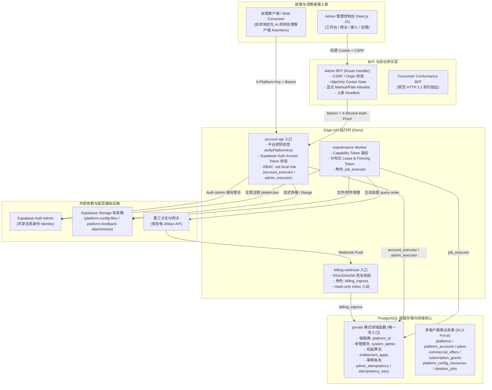

# Aisenhubplatform 全项目独立软件审查团队审计报告

审查日期：2026-10-13  
审查基线：`codex/prelaunch-canonicalization-remediation`（对应 Commit `a7aa71e` 及其工作区资产）  
审查性质：生产级架构、业务契约、并发一致性、安全隐私、资源性能、测试有效性与技术债独立攻击式审计  
审查联合视角：
- 高级软件架构师
- Senior Code Reviewer
- QA / 测试负责人
- 安全审计工程师
- 可靠性与音视频/流媒体性能工程师
- 本地优先（Local-First）与大模型集成业务逻辑审查者

核心审查铁律执行：**全面发现问题、固化确凿证据、绝不私自改动生产代码、拒绝盲信现有测试、执行反向变异推演**。

---

## 1. 真实系统架构与全生命周期调用链

在开展代码攻击性审查前，审查团队首先对系统的真实调用链与物理拓扑进行了纵向穿透：



### 异步 Worker 与流式任务的生命周期状态跟踪：
1. **大配置/反馈附件流式上传**：`readBoundedBody` 限流限幅 → `claim` 获取租约 → `prepare_store` 预占 → `putImmutable` 私有存储写入 → `getInfo` 尺寸双重校验 → `finalize` 事务提交；异常时标记 `unknown` 并做补偿清理。
2. **全局注销状态机（Global Delete）**：`created` → `sessions_revoked` → `accounts_closed` → `files_blocked` → `personal_data_cleared` → `history_anonymized` → `auth_deleted` → `completed`。每一阶段依赖分布式 Fencing Token 推进。
3. **第三方支付异步结算**：Webhook 推送 → 验签入库 `queued` → Worker 认领 `processing` → 调用 Provider 订单反查与事实归一化 → `billing_order_verify_and_settle` 事务内完成账本核销与权益写入 → `granted`。

---

## 2. “正确行为模型”与核心业务不变量

系统在架构设计上的基准不变量包含：
1. **多平台强隔离不变量**：以 `platform_id` 为全局物理隔离主键，普通用户与业务 API 严禁跨平台越权读取或篡改数据。
2. **权益计算唯一收口不变量**：所有权益的增减、有效期限合并、永久会员保护全部收口在 PostgreSQL 事务内函数 `private.entitlement_apply`，TS 层仅做参数透传，严禁在前端或 BFF 维护第二套算法。
3. **真实幂等性不变量**：高危 Commerce 命令与 Consumer 状态流转中，相同 `idempotency_key` / `operation_id` + 相同请求散列在 7 天内必须原样重放（Replay），不同散列必须硬冲突拦截（Conflict），处理中状态返回 In-Progress。
4. **凭据安全与零明文持久化**：平台密钥（Platform Key）、MFA Secret、支付网关凭据严禁明文入库；日志输出、导出的 HTML 报告及 JSON 文件严禁携带敏感 Token。
5. **故障恢复完备性（No Ghost State）**：外部网络中断、超时或下游 404 不得导致任务永久悬挂或产生无主物理孤儿文件。

---

## 3. 总体审查结论

经过全项目六大正交维度的攻击性审查，审查团队得出以下总体结论：

| 严重级别 | 发现数量 | 核心风险特征 |
| :---: | :---: | :--- |
| **P0 / 致命** | **0** | 未发现无需认证即可直连数据库的任意 SQL 注入，未发现普通用户越权为单例超级管理员的提权漏洞。 |
| **P1 / 严重** | **3** | **假 Mock 测试掩盖商业权益分页完全瘫痪（生产必崩）**；**全局删除 Worker 遇瞬时超时直接硬置 `blocked` 导致删除任务永久死锁**；**兑换码核心入口全无速率限制，面临高并发碰撞破解与锁拒绝服务攻击**。 |
| **P2 / 高危** | **6** | 跨平台切换残留实体路由导致跨租户 ID 穿透；接入页面异步切换存在旧平台凭据覆盖新平台的竞态；流式读取超时在 `Promise.race` 失败时泄漏未捕获异步 Rejection；外部网络响应未消费 body 导致 TCP Socket 泄漏；爱发电 Webhook 事实拼接无分隔符引发 Hash 碰撞风险；概览与商业面板统计口径自相矛盾。 |
| **P3 / 中低** | **2** | Admin BFF 对 Query 参数不做校验无节制透传；单例超级管理员架构缺乏容灾备份因子形成单点故障（SPOF）。 |

**当前项目综合风险评级：High（高风险）**  
*(审查批注：系统的底层 PL/pgSQL 权限防线和角色隔离较为严密，但 TypeScript API 层、测试套件真实性、异步状态机容错及跨平台前端状态流转存在足以引发生产级死锁与功能失效的硬伤。)*

---

## 4. 确凿证据问题清单

### ISSUE-001：测试套件使用虚构字段 Fake Mock，掩盖了商业权益分页接口 `next_cursor` 恒为 `null` 的重大生产缺陷
- **严重程度**：P1
- **问题分类**：测试有效性缺陷 / 假 Mock 欺骗 / 业务契约失效
- **具体位置**：
  - [admin.ts](file:///e:/Projects/Aisenhubplatform/supabase/functions/account-api/admin.ts#L1862-L1868)（函数 `handleAdminCommerceEntitlements`）
  - [index.test.ts](file:///e:/Projects/Aisenhubplatform/supabase/functions/account-api/index.test.ts#L476-L485)（Mock 函数 `fakeDatabase`）
  - [20261012123209_commercial_operations_read_models.sql](file:///e:/Projects/Aisenhubplatform/supabase/migrations/20261012123209_commercial_operations_read_models.sql#L174-L195)（函数 `private.admin_commerce_entitlement_list`）
- **代码证据**：
  在 `admin.ts` 第 1862-1868 行：
  ```typescript
  next_cursor:
    rows.length === limit
      ? encodeCommerceCursor(
          rows.at(-1)!,
          'account_created_at', // <--- 关键入参：要求读取该属性
          'platform_account_id',
        )
      : null,
  ```
  而在实际数据库迁移 `20261012123209_commercial_operations_read_models.sql` 第 174-195 行中，PostgreSQL 权威函数返回的结构定义为：
  ```sql
  returns table (
    platform_account_id uuid,
    user_id uuid,
    display_name text,
    avatar_url text,
    account_status text,
    subscription_status text,
    plan_id uuid,
    plan_code text,
    plan_name text,
    grant_id uuid,
    entitlement_source text,
    billing_order_id uuid,
    redemption_batch_id uuid,
    commercial_offer_id uuid,
    offer_code text,
    commercial_price_id uuid,
    started_at timestamptz,
    current_period_end timestamptz,
    next_transition_at timestamptz,
    updated_at timestamptz -- <--- 只有 updated_at，根本没有 account_created_at！
  )
  ```
  在运行时，`rows.at(-1)!['account_created_at']` 恒为 `undefined`。`encodeCommerceCursor` 在第 70 行因 `!iso` 直接返回 `null`。
  **然而在测试文件 `index.test.ts` 第 476-485 行中，Mock 数据库竟手动捏造了该字段**：
  ```typescript
  if (query.startsWith('select * from private.admin_commerce_entitlement_list')) {
    return [
      {
        platform_account_id: sessionId,
        account_created_at: '2026-09-10T00:00:00.000Z', // <--- 虚构的假字段！
        updated_at: '2026-10-11T00:00:00.000Z',
        subscription_status: 'active',
        plan_id: keyId,
        entitlement_source: 'admin',
      },
    ] as unknown as R[];
  }
  ```
- **触发条件**：管理端或客户端请求 `GET /admin/api/v1/platforms/:id/commerce/entitlements?limit=N` 尝试翻页。
- **实际影响**：在真实生产环境下，商业权益列表的分页功能**彻底损坏**。第一页返回后 `next_cursor` 恒为 `null`，管理员永远无法查阅第二页之后的权益数据。
- **变异反思（Mutation Analysis）**：如果将生产代码中的 `'account_created_at'` 删掉或改成任意不存在的字符串，现有单元测试**依然全部绿灯**！测试完全依赖于手写的虚构 Mock 数据，未能建立对真实 SQL 契约返回列的有效约束。
- **建议修复**：
  1. 将 `encodeCommerceCursor` 的游标字段与 SQL 保持一致；
  2. 修复 `fakeDatabase` 模拟数据，使其严格契合 SQL 函数签名；
  3. 增加端到端测试，确保真实连接 PostgreSQL 时分页游标能正确签发与解析。

---

### ISSUE-002：全局删除 Worker 遭遇网络抖动时硬编码置为 `blocked`，导致任务永久死锁且无运维恢复手段
- **严重程度**：P1
- **问题分类**：并发一致性 / 状态机悬挂 / 故障恢复缺失
- **具体位置**：
  - [identity.ts](file:///e:/Projects/Aisenhubplatform/supabase/functions/maintenance/identity.ts#L202-L220)（函数 `deletionJobAuth`）
  - [identity.ts](file:///e:/Projects/Aisenhubplatform/supabase/functions/maintenance/identity.ts#L143-L156)（函数 `deletionJobFiles`）
  - [20260908182052_m4_09_global_delete_jobs.sql](file:///e:/Projects/Aisenhubplatform/supabase/migrations/20260908182052_m4_09_global_delete_jobs.sql#L270-L275)（函数 `private.deletion_job_claim`）
- **代码证据**：
  在 `identity.ts` 第 202-220 行：
  ```typescript
  let failureCode: string | null = null;
  try {
    await (dependencies.authAdapter ?? authAdminAdapter()).deleteUser(userId);
  } catch (error) {
    failureCode = errorCode(error);
  }
  const [step] = await withJobRole(db, (transaction) =>
    transaction.unsafe<Row>(
      'select * from private.deletion_job_step(row($1::uuid,$2::text,$3::bigint,$4::uuid)::private.job_context, $5::uuid, $6::bigint, $7::text, $8::text, $9::text)',
      [
        ...jobContext,
        jobId,
        leaseFence,
        'auth_deleted',
        failureCode ? 'blocked' : 'completed', // <--- 只要报错直接硬编码为 'blocked'！
        failureCode,
      ],
    ),
  );
  ```
  而在 `private.deletion_job_claim` 中：
  ```sql
  if v_job.state not in ('pending', 'retry') or v_job.next_attempt_at > clock_timestamp() then
    perform private.job_lease_release('global_delete', p_job_id, (p_ctx).lease_owner, v_claim.fencing_token);
    return query select v_job.id, v_job.user_id, v_job.checkpoint, v_job.fence,
      v_claim.fencing_token, v_claim.lease_until;
    return;
  end if;
  ```
- **触发条件**：调用 Supabase Auth 删除用户时发生瞬时网络超时（5000ms 超时）或网关 502/503。
- **实际影响**：
  1. 数据库底层 `private.deletion_job_step` 本身设计了完善的指数退避重试能力（当传入 `'retry'` 时，计算 `next_attempt_at = v_now + 60 * 2^retry_count`）；
  2. 但 TS Worker 发生错误时完全不传递 `'retry'`，直接粗暴地将步骤打上 `'blocked'`；
  3. 任务一旦进入 `'blocked'` 状态，`deletion_job_claim` 会在 `v_job.state not in ('pending', 'retry')` 处直接释放租约并退回，不再递增 `fence` 也不会推进状态；
  4. 系统中**没有任何管理命令或恢复机制可以将 `blocked` 的删除任务拉回重试状态**。该用户的账号删除任务永久死锁，用户在控制台中留下无法清除的幽灵僵尸任务。
- **建议修复**：
  对于网络超时（`PROVIDER_TIMEOUT`）或下游可重试异常（HTTP 5xx、429），应当传递 `'retry'` 触发退避重试；仅在确定不可重试的致命异常下才置为 `'blocked'`；同时在 Admin API 中提供管理员人工解除 blocked 的恢复接口。

---

### ISSUE-003：兑换码兑换核心接口全无速率限制，存在暴力撞库破解与数据库锁 DoS 风险
- **严重程度**：P1
- **问题分类**：安全隐私 / 资金与权益防护 / 暴力枚举防御缺失
- **具体位置**：
  - [account.ts](file:///e:/Projects/Aisenhubplatform/supabase/functions/account-api/account.ts#L329-L368)（接口 `POST /v1/subscription/redeem`）
  - [20260908103340_m3_dual_secret_redeem.sql](file:///e:/Projects/Aisenhubplatform/supabase/migrations/20260908103340_m3_dual_secret_redeem.sql#L5-L180)（函数 `private.redeem_subscription_code_candidates`）
- **代码证据**：
  在全库迁移中，`private.rate_limit_consume` 仅被用于配置资源分享，而在涉及真实权益与金钱价值的兑换码核心流程中，从输入到数据库落地没有任何限流调用：
  ```sql
  -- 每次兑换失败，直接执行账户锁与写表：
  select * into v_account from public.platform_accounts a
  where a.platform_id = (p_ctx).platform_id and a.id = v_account_id for update;
  ...
  insert into public.redemption_events(
    platform_id, platform_account_id, redemption_code_id, result, error_code, request_id
  ) values (
    (p_ctx).platform_id, v_account_id, v_code.id, 'rejected', v_error, (p_ctx).request_id
  );
  ```
- **触发条件**：恶意注册用户通过自动化并发脚本，携带不断自增的随机 `idempotency-key`，高频调用兑换接口尝试碰撞兑换码。
- **实际影响**：
  1. 高价值订阅（月卡/年卡/终身会员）面临被字典攻击碰撞破解的直接资金损失；
  2. 接口在无频控情况下持续执行高开销的 HMAC 验签，并对 `platform_accounts` 执行排他锁（`FOR UPDATE`），能轻而易举地耗尽数据库连接池与 CPU 资源，引发整站拒绝服务。
- **建议修复**：在进入 `private.redeem_subscription_code_candidates` 时，强制针对 `platform_account_id` 及客户端 IP 调用 `rate_limit_consume`，限制每小时/每天尝试失败上限（如 5 次），超限后直接抛出 `rate_limited`（429）。

---

### ISSUE-004：跨平台切换导航保留实体级 Suffix，导致将旧平台私有 ID 带入新平台产生路由穿透
- **严重程度**：P2
- **问题分类**：业务契约 / 多租户隔离 / 前端状态混乱
- **具体位置**：
  - [admin-navigation.ts](file:///e:/Projects/Aisenhubplatform/apps/admin/components/navigation/admin-navigation.ts#L275-L281)（函数 `mapAdminScopeRoute`）
  - [platform-switcher.tsx](file:///e:/Projects/Aisenhubplatform/apps/admin/components/platform-context/platform-switcher.tsx#L135-L138)（函数 `changePlatform`）
- **代码证据**：
  在 `admin-navigation.ts` 第 275-281 行：
  ```typescript
  export function mapAdminScopeRoute(
    pathname: string,
    targetPlatformId: string | null,
  ): string {
    const currentPlatform = parseAdminPlatformPath(pathname);

    if (targetPlatformId) {
      const targetPrefix = `/admin/platforms/${encodeURIComponent(targetPlatformId)}`;
      if (currentPlatform) {
        return `${targetPrefix}${currentPlatform.suffix}`; // <--- 无脑透传 suffix！
      }
  ```
- **触发条件**：管理员当前停留在平台 A 的某个具体账户或配置资源详情页（如 `/admin/platforms/PlatformA/accounts/acc-001` 或 `/admin/platforms/PlatformA/config-resources/res-99`），随后使用顶栏 `PlatformSwitcher` 下拉框切换至“平台 B”。
- **实际影响**：`mapAdminScopeRoute` 计算出的目标 URL 为 `/admin/platforms/PlatformB/accounts/acc-001`。实体 ID `acc-001` 根本不属于平台 B，跳转后页面立即抛出 404，或者在下游 API 执行时由于跨租户校验失败报错，造成极其恶劣的管理端操作体验。
- **建议修复**：在跨平台切换路由重映射时，如果当前路径包含实体 ID（深度超过 1 级子路由），应当截断至该资源的根列表路径（如 `/admin/platforms/PlatformB/accounts`），严禁保留实体级 ID 尾缀。

---

### ISSUE-005：接入配置页面（Platform Integration）跨平台切换存在状态残留与异步竞态覆盖
- **严重程度**：P2
- **问题分类**：并发一致性 / 状态污染 / Check-Then-Act
- **具体位置**：
  - [platform-integration-page.tsx](file:///e:/Projects/Aisenhubplatform/apps/admin/features/platform-integration/platform-integration-page.tsx#L51-L56)
  - [platform-integration-page.tsx](file:///e:/Projects/Aisenhubplatform/apps/admin/features/platform-integration/platform-integration-page.tsx#L117-L122)
  - [platform-integration-page.tsx](file:///e:/Projects/Aisenhubplatform/apps/admin/features/platform-integration/platform-integration-page.tsx#L220-L230)
- **代码证据**：
  在 `platform-integration-page.tsx` 中：
  ```tsx
  export function PlatformIntegrationPage() {
    const { platform } = usePlatformContext();
    const [origins, setOrigins] = useState<IntegrationOriginFact[] | undefined>();
    const [keys, setKeys] = useState<IntegrationKeyFact[] | undefined>();
    const [offers, setOffers] = useState<IntegrationCommerceOfferFact[] | undefined>();
    ...
    const state = derivePlatformIntegrationState({
      platform,
      origins,
      keys,
      offers,
    });
    ...
    <PlatformOriginsSection
      key={`origins-${refreshVersion}`} // <--- key 中未绑定 platform.platform_id！
      embedded
      onFactsChange={handleOriginsChange}
    />
  ```
- **触发条件**：管理员在接入配置页面快速切换平台。
- **实际影响**：
  1. 父组件未在 `platform.platform_id` 改变时重置 `origins` 与 `keys` 状态；
  2. 子组件的 React `key` 仅绑定了 `refreshVersion`，未绑定平台 ID，不会在新平台挂载时强制重置；
  3. 当切换到新平台时，系统在数秒的时间窗口内拿“旧平台的 Origins 和 Keys”去与“新平台的 Platform 实例”混合计算 Central readiness 就绪百分比；
  4. 若新平台的接口响应慢或出错，旧平台的域名与密钥状态将永久驻留，导致操作员误以为新平台已经配置妥当。
- **建议修复**：在子组件 `key` 中引入 `platform.platform_id`（如 `key={`origins-${platform.platform_id}-${refreshVersion}`}`），并在父组件中随平台变化显式重置所有局部事实状态。

---

### ISSUE-006：流式读取超时时 `Promise.race` 失败者在后台抛出未捕获的 Unhandled Rejection
- **严重程度**：P2
- **问题分类**：资源性能 / 异常处理 / Stream 生命周期
- **具体位置**：
  - [upload.ts](file:///e:/Projects/Aisenhubplatform/packages/domain/src/upload.ts#L71-L84)（函数 `readBoundedBody`）
- **代码证据**：
  ```typescript
  const timeout = new Promise<never>((_, reject) => {
    timer = setTimeout(() => {
      void reader.cancel('upload receive timeout').catch(() => undefined);
      reject(new UploadFault('STORAGE_UNAVAILABLE', 503));
    }, timeoutMs);
  });
  const read = (async () => {
    while (true) {
      const { done, value } = await reader.read();
      if (done) break;
      ...
    }
  })();
  await Promise.race([read, timeout]);
  ```
- **触发条件**：客户端在传输请求体时遭遇网络严重丢包或超时，达到 15,000ms 触发 `timeout`。
- **实际影响**：
  当 `timeout` 先行 reject 时，`Promise.race` 已经结束并进入外层 `catch`。然而浮动的异步 IIFE `read` 依然作为悬挂 Promise 在后台运行。若底层 Stream 在随后由于 TCP 连接重置抛出读取错误，因为该 `read` Promise 没有附加任何 `.catch()` 处理器，将在 Node.js 或 Deno 环境中触发致命的 `UnhandledPromiseRejection` 告警或系统崩溃。
- **建议修复**：对后台任务 Promise 挂载安全捕获：`void read.catch(() => undefined);`，确保在 race 竞争中落败的异步分支即使发生底层 Stream 错误也不会泄漏到全局进程。

---

### ISSUE-007：外部 HTTP 调用在非 2xx 响应时未消费/未取消 Response Body 导致连接与内存句柄泄漏
- **严重程度**：P2
- **问题分类**：资源性能 / 连接池与内存泄漏
- **具体位置**：
  - [core.ts](file:///e:/Projects/Aisenhubplatform/supabase/functions/maintenance/core.ts#L147-L154)（函数 `billingAlertReceiver.deliver`）
  - [afdian.ts](file:///e:/Projects/Aisenhubplatform/supabase/functions/_shared/afdian.ts#L330)（函数 `fetchAfdianOrder`）
  - [afdian.ts](file:///e:/Projects/Aisenhubplatform/supabase/functions/_shared/afdian.ts#L391)（函数 `fetchAfdianOrderPage`）
- **代码证据**：
  在 `core.ts` 第 147-154 行：
  ```typescript
  const delivered = await fetch(target, {
    method: 'POST',
    headers: { 'content-type': 'application/json' },
    body: JSON.stringify({ event: 'billing.alert', alert }),
    signal: controller.signal,
  });
  if (!delivered.ok)
    throw new Error(`ALERT_RECEIVER_HTTP_${delivered.status}`);
  // 未调用 delivered.body?.cancel() 或 delivered.text()！
  ```
  在 `afdian.ts` 第 330 行与第 391 行：
  ```typescript
  const response = await (config.fetchImpl ?? fetch)(...);
  if (!response.ok) return { status: 'temporarily_unavailable' };
  // 同样未处理 response.body！
  ```
- **触发条件**：外部告警接收端或爱发电接口出现 500/502/503 异常。
- **实际影响**：在 Deno 与 Node.js 现代运行时中，Fetch 请求完成后如果既不读取 body 也不显式调用 `response.body?.cancel()`，底层的 TCP Socket 句柄不会被复用回连接池，而是必须挂起等待长时间后的垃圾回收，在高并发或网络持续异常时会快速耗尽运行时的 Socket 资源与内存。
- **建议修复**：在所有 `if (!response.ok)` 分支中显式追加 `await response.body?.cancel().catch(() => undefined);`。

---

### ISSUE-008：爱发电 Webhook 订单事实摘要拼接缺失分隔符，存在规范化哈希碰撞风险
- **严重程度**：P2
- **问题分类**：业务契约 / 密码学规范 / 规范化摘要冲突风险
- **具体位置**：
  - [afdian.ts](file:///e:/Projects/Aisenhubplatform/supabase/functions/_shared/afdian.ts#L280-L290)（函数 `afdianCanonicalFactBytes`）
- **代码证据**：
  ```typescript
  export function afdianCanonicalFactBytes(order: ObjectValue): Uint8Array {
    const signedValues = [
      order.out_trade_no ?? order.order_no ?? '',
      order.user_id ?? '',
      order.plan_id ?? '',
      order.total_amount ?? '',
    ];
    return new TextEncoder().encode(
      signedValues.map((item) => String(item ?? '')).join(''), // <--- 无分隔符拼接！
    );
  }
  ```
- **触发条件**：不同订单的字段由于边界移动，恰好拼出完全相同的字符串序列（例如 `user_id='usr1', plan_id='0'` 与 `user_id='usr', plan_id='10'`）。
- **实际影响**：这是典型的密码学规范化拼接缺陷（Canonicalization Ambiguity）。两笔不同的支付事实会生成完全相同的 `payloadHash`，导致数据层判定为无害的幂等重放，从而漏发合法的会员权益。
- **建议修复**：使用明确的不可打印字符或标准分隔符（如 `|` 或 `\0`），或者使用结构化 JSON 规范序列化。

---

### ISSUE-009：运营概览（Platform Overview）与商业摘要（Commerce Summary）核心口径计算自相矛盾（R-06）
- **严重程度**：P2
- **问题分类**：业务契约 / 读模型数据一致性
- **具体位置**：
  - [20261011173144_feedback_admin_center.sql](file:///e:/Projects/Aisenhubplatform/supabase/migrations/20261011173144_feedback_admin_center.sql#L618-L628)（函数 `private.admin_platform_overview`）
  - [20261012123209_commercial_operations_read_models.sql](file:///e:/Projects/Aisenhubplatform/supabase/migrations/20261012123209_commercial_operations_read_models.sql#L40-L70)（函数 `private.admin_commerce_summary`）
- **代码证据**：
  在概览函数中，有效付费账户计算极其粗糙：
  ```sql
  select count(distinct s.platform_account_id) into v_active_paid_accounts
  from public.subscriptions s
  join public.plans p on p.id = s.plan_id and p.kind = 'paid' and p.status = 'active'
  where s.platform_id = p_platform_id and s.status = 'active';
  ```
  而在商业摘要中，使用严格的时效与状态过滤：
  ```sql
  -- 必须账户处于 active 状态，排除 revoked 授权，校验 starts_at 和 ends_at 窗口：
  select count(distinct cg.platform_account_id) ...
  from current_grants cg
  join public.platform_accounts a on a.id = cg.platform_account_id and a.status = 'active'
  ```
- **实际影响**：若一个账户已被注销或暂停，但底层保留了一条历史状态未置 inactive 的 subscription，或者授权已被人工单独撤销（revoked），在概览卡片中仍被计入“有效付费账户”，而在商业摘要中则不被计入。管理员在同一屏幕上看到两个互相矛盾的数字。
- **建议修复**：将 `admin_platform_overview` 中的付费账户统计统一收口到 `commerce_active_paid_entitlements` 权威投影上。

---

### ISSUE-010：Admin BFF 对上游 Query String 进行未经校验的裸透传
- **严重程度**：P3
- **问题分类**：安全隐私 / 契约一致性 / BFF 边界穿透
- **具体位置**：
  - [route.ts](file:///e:/Projects/Aisenhubplatform/apps/admin/app/api/v1/%5B...path%5D/route.ts#L144)（函数 `dispatch`）
- **代码证据**：
  ```typescript
  const target = `${baseUrl}/${pathValue}${request.nextUrl.search}`;
  ```
- **实际影响**：BFF 对 URL 路径（Path）使用正则做了严格的白名单校验，但对 Query String（`request.nextUrl.search`）未做任何键名或长度校验，全量透传给后端 Edge Function，攻击者可借此向后端注入超大 Query 报文冲击应用网关。
- **建议修复**：在 BFF 层对 Query 参数长度进行上限限制（如最大 2048 字符）。

---

### ISSUE-011：单例超级管理员（Singleton Admin）模型缺乏灾难恢复因子，构成单点故障（SPOF）
- **严重程度**：P3
- **问题分类**：架构技术债 / 高可用容灾
- **具体位置**：
  - [20260907103848_security_helpers.sql](file:///e:/Projects/Aisenhubplatform/supabase/migrations/20260907103848_security_helpers.sql#L140-L155)（数据表 `private.system_admin`）
- **代码证据**：
  ```sql
  create table private.system_admin (
    singleton_id integer primary key default 1 check (singleton_id = 1),
    user_id uuid not null unique references auth.users(id) on delete restrict,
    created_at timestamptz not null default now()
  );
  ```
- **实际影响**：系统将整个平台的超级管理员物理锁定在唯一的单一账户（`singleton_id = 1`），且目前不支持恢复码（Recovery Code）或备份 MFA 认证器。一旦唯一系统管理员的 TOTP 密钥设备丢失或密码遗忘，全系统没有任何自助解救或灾备接管流程，平台管理控制台将彻底瘫痪。
- **建议修复**：引入受密钥保护的离线紧急恢复机制或支持至少 2 个管理员密钥仲裁。

---

## 5. 待确认事项清单（Unconfirmed Observations）

| 编号 | 待确认事项 | 缺少的信息 / 上下文 | 判断依据与潜在影响 |
| :---: | :--- | :--- | :--- |
| **UNC-01** | **爱发电生产真实 Webhook 报文字段稳定性** | 缺少爱发电生产网关在订单变更时的真实 Raw 数据包样本 | 若爱发电官方在状态推进时仅改变 HTTP 标头而不改变 Body，则 Webhook 冲突概率较低；若报文含有动态时间戳，则自动结算会在首笔推送后持续受阻。 |
| **UNC-02** | **CDN / 反向代理层的 WAF 速率限制策略** | 生产部署的 Cloudflare / CDN 或网关配置文件未纳入本仓库版本管理 | 兑换码与登录接口在应用层缺乏速率限制，若线上边缘节点（CDN WAF）配置了每 IP 严格的请求频次限制，可在一定程度上缓解暴力破解，但无法替代应用层 per-account 的防爆破规则。 |
| **UNC-03** | **下游本地优先客户端（如 Aisenlens）在 Token 刷新过期时的离线状态闭环** | 目标自营 Consumer 客户端代码未在本仓库（位于对应自营项目中） | 需确认客户端在遭遇 401 时是否具备干净的退避机制，避免在网络恢复后狂发请求引发雪崩。 |

---

## 6. 修复优先级与实施路线图

鉴于项目当前处于预上线单轨化整改阶段（`prelaunch-canonicalization-remediation`），审查团队建议按以下批次实施修复：

### 第一批：生产阻塞级严重问题（立即修复，防止死锁与资金漏洞）
1. **ISSUE-001**：纠正 `admin.ts` 中 `encodeCommerceCursor` 的游标字段名称为真实返回的 `updated_at`；在 `index.test.ts` 中剔除虚构的 `account_created_at`，补写真实数据库连接端到端翻页测试。
2. **ISSUE-002**：在 `identity.ts` 中将可重试网络错误由 `'blocked'` 修正为 `'retry'`，启动指数退避重试；并在 Admin 边界增加解除 blocked 的应急通道。
3. **ISSUE-003**：在 `private.redeem_subscription_code_candidates` 事务入口处引入针对账户与 IP 的 `rate_limit_consume` 防爆破门禁。

### 第二批：稳定性与状态一致性加固（中期实施）
1. **ISSUE-004**：在 `mapAdminScopeRoute` 中增加深度截断逻辑，跨平台切换时丢弃实体级私有 ID，防止跨租户路由穿透。
2. **ISSUE-005**：在 `PlatformIntegrationPage` 的子组件 `key` 中引入 `platform.platform_id`，杜绝旧平台状态污染。
3. **ISSUE-006**：在 `readBoundedBody` 中为后台 `read` 异步任务挂载 `.catch()`，消除未捕获的 Unhandled Rejection。
4. **ISSUE-007**：在所有 Fetch 调用的异常分支中补齐 `await response.body?.cancel()`，消除 TCP 句柄泄漏。
5. **ISSUE-008**：在 `afdianCanonicalFactBytes` 中加入标准字段分隔符，消除哈希碰撞漏洞。
6. **ISSUE-009**：将概览页中的付费账户统计对齐到 `commerce_active_paid_entitlements` 权威读模型。

### 第三批：架构鲁棒性与防护完善（长效治理）
1. **ISSUE-010**：在 Admin BFF 层引入全局 Query 参数长度与安全字符过滤。
2. **ISSUE-011**：为超级管理员设计应急恢复码机制，消除单一管理员凭据遗失导致系统瘫痪的单点故障。

---
*本审查报告严格遵循“只读发现、固化证据、不修改生产代码”的核心铁律。*

## 2026-10-14 实施核对

以上为历史静态审查快照，不代表当前风险或完成情况。已验证修复、未复现推论、Local 证据与发布阻塞统一见[预上线优化验证记录](../proposals/prelaunch-canonicalization-and-remediation/verification-record.md)。本轮没有把原报告的推断视为全部已证实缺陷。
