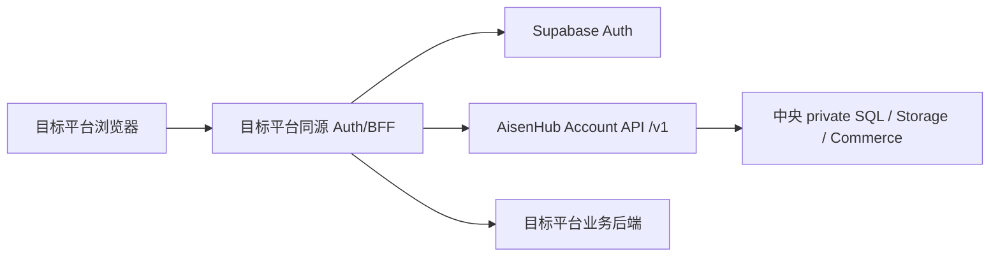

# AisenHub Platform Integration

这是新平台接入 AisenHub 中央能力的**开发者唯一推荐入口**。目标平台不安装 AisenHub runtime SDK，也不复制中央业务包；它按 canonical HTTP contract 自行拥有 Auth、同源 BFF、业务授权与可选能力集成。

AI Agent 请先阅读 [`AGENTS.md`](./AGENTS.md)。机器可读入口见 [`manifest.json`](./manifest.json) 与 [`ai/capabilities.json`](./ai/capabilities.json)。

## 1. 系统边界



必须保持：

- Platform Key 只存在目标平台可信服务端。
- 浏览器只调用同源 BFF，不直接持有 access token、refresh token 或 Platform Key。
- 公共 API 字段、鉴权、错误码和状态以 [`../contracts/account/v1/openapi.json`](../contracts/account/v1/openapi.json) 为唯一事实源。
- 目标平台负责自己的页面、业务资源和业务数据归属；AisenHub 负责共享身份、平台账户、权益、Config、Feedback、Commerce 等中央能力。
- 中央不可用或授权状态不确定时 fail closed。

## 2. 最小接入闭环

按下面顺序实施，不要先复制全部能力：

1. 固定中央 commit、Account contract major 和 changelog revision。
2. 在 Admin `平台设置 → 接入配置` 完成 Platform、Origin/callback、Platform Key 和部署确认。
3. 在目标平台实现 Auth session 与同源 BFF。
4. 调用 `GET /v1/account/principal`。
5. 对 `not_activated` 用户按产品策略调用 `POST /v1/account/activate`。
6. 在一个真实服务端业务路由中接入 entitlement/feature guard。
7. 只接产品实际需要的 Profile、Config、Feedback、Commerce、Lifecycle 等能力。
8. 执行中央 Conformance 与目标平台自己的 typecheck/build/unit/E2E。
9. 记录 contract baseline、验证证据、未完成项和生产门槛。

详细步骤见 [`guides/quick-start.md`](./guides/quick-start.md)。

## 3. 核心配置语义

目标仓库变量名可以不同，但安全语义必须等价：

```dotenv
CONSUMER_ORIGIN=http://localhost:3001
ACCOUNT_API_URL=http://127.0.0.1:8000
ACCOUNT_API_TIMEOUT_MS=5000
ACCOUNT_PLATFORM_KEY=
SUPABASE_URL=http://127.0.0.1:54321
SUPABASE_PUBLISHABLE_KEY=
```

示例文件见 [`examples/env.example`](./examples/env.example)。Consumer 不需要中央数据库 URL、Supabase service role、HMAC、Maintenance token、Provider token 或 webhook secret。

## 4. 能力目录

| 能力 | 是否核心 | 开发指南 |
| --- | --- | --- |
| Auth / Session | 是 | [authentication](./guides/authentication.md) |
| Principal / Activation | 是 | [account](./guides/account.md) |
| Authorization / Entitlement | 是 | [authorization](./guides/authorization.md) |
| Errors / Observability | 是 | [errors-observability](./guides/errors-observability.md) |
| Profile / Preferences | 按需 | [account](./guides/account.md) |
| Config / Version | 按需 | [config](./guides/config.md) |
| Config Gallery | 按需 | [config](./guides/config.md) |
| Feedback | 按需 | [feedback](./guides/feedback.md) |
| Commerce / Subscription | 按需 | [commerce](./guides/commerce.md) |
| Lifecycle | 按需 | [account](./guides/account.md) |

机器可读 capability → `operationId` 映射见 [`ai/capabilities.json`](./ai/capabilities.json)。该文件不复制 request/response schema。

## 5. Contract 与版本

Canonical Account API：

- OpenAPI: [`../contracts/account/v1/openapi.json`](../contracts/account/v1/openapi.json)
- Compatibility: [`../contracts/account/v1/COMPATIBILITY.md`](../contracts/account/v1/COMPATIBILITY.md)
- Changelog: [`../contracts/account/v1/CHANGELOG.md`](../contracts/account/v1/CHANGELOG.md)

本目录的 [`contracts/account/v1/README.md`](./contracts/account/v1/README.md) 只保存版本指针和使用规则，不维护第二份 schema。

## 6. Conformance

中央仓库使用 `tests/consumer-harness` 作为 test-only 独立 Consumer fixture。稳定入口与 PASS 语义见 [`conformance/README.md`](./conformance/README.md)。

```powershell
pnpm platform-integration:check
pnpm test:registry
pnpm test:consumer-harness
pnpm test:e2e:consumer-harness
```

Conformance PASS 证明公共 HTTP/安全边界可被独立 Consumer 实现；它不等于目标平台生产 Secret 已部署、生产发布已授权或真实 Provider 已联调。

## 7. 分主题指南

- [Quick Start](./guides/quick-start.md)
- [Authentication / Session](./guides/authentication.md)
- [Account / Profile / Lifecycle](./guides/account.md)
- [Authorization / Entitlement](./guides/authorization.md)
- [Config / Gallery](./guides/config.md)
- [Feedback](./guides/feedback.md)
- [Commerce](./guides/commerce.md)
- [Files / Binary](./guides/files.md)
- [Errors / Observability](./guides/errors-observability.md)

## 8. 不要做的事

- 不把 `tests/consumer-harness` 当生产 starter 复制。
- 不依赖 `packages/domain` 或 Admin private helper 作为 Consumer runtime。
- 不创建浏览器任意 URL 代理。
- 不让浏览器直接访问私有 Storage。
- 不根据 UI、回调 query 或本地缓存自行重算 entitlement、付款状态或配额。
- 不把 Admin “中央准备就绪”误写成目标平台 Auth/BFF/E2E 已完成。
- 不在文档、日志、聊天、URL 或客户端 bundle 中保存真实 Secret。
